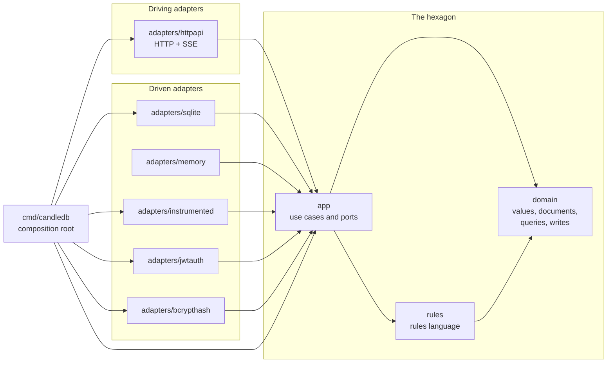

# Hexagonal architecture

This is the third documentation track. It assumes you have used the tool
([tour](../tour/01-quickstart.md)) and read the Go chapters
([go](../go/00-how-to-read-this.md)). Here the subject is the shape of the
program: why the code is split into the packages it is, and which package is
allowed to know about which.

## The problem

Imagine candledb written the direct way. The handler for
`PUT /v1/documents/users/ada` parses the JSON, opens a SQLite transaction,
checks the security rules with a few `if` statements, writes the row, writes
the index rows, and then loops over the open listen connections to tell them
what changed. It would work, and for a weekend prototype it would be fine.

The trouble starts when anything has to change:

- **Testing a rule needs a database and an HTTP request.** To check "bob may
  not edit ann's note" you would start a server, create a database file and
  send requests. The test is slow, and when it fails you do not know whether
  the rule, the SQL or the JSON parsing is wrong.
- **A second way in duplicates the logic.** `PUT`, `PATCH`, `POST` and the
  batch endpoint all write documents. If each handler carries its own copy of
  "check the precondition, apply the write, check the rules, store, notify",
  the copies drift apart, and one of them eventually forgets the rules check.
- **Storage details leak everywhere.** Once handlers contain SQL, replacing
  SQLite, or only adding an in-memory store for tests, means editing every
  handler.
- **Nobody can say what the program does.** The answer to "what happens when
  a document is written?" is spread over HTTP code, SQL strings and
  connection bookkeeping.

All four problems have one cause: the code that decides *what the database
does* is mixed with the code that deals with *the outside world* (HTTP,
SQLite, the clock, the password hashing library).

## The idea

Hexagonal architecture, also called ports and adapters, separates those two
kinds of code and fixes the direction in which they may depend on each other.
Alistair Cockburn described it in 2005. The hexagon in the name carries no
meaning; it is only a shape with enough sides to draw several connections on.

The vocabulary:

- **Domain** (or core): the concepts of the problem and the rules that hold
  for them regardless of technology. In candledb: values, documents, paths,
  queries, writes, and the security rules language.
- **Application** (or use cases): the operations the system offers, written
  in terms of the domain. In candledb: get a document, run a query, commit a
  batch of writes, listen for changes, sign up, sign in.
- **Port**: an interface that the application defines to describe something
  it needs from outside, in its own vocabulary. "Something that can store
  documents" is a port. It says nothing about SQL.
- **Adapter**: code that connects a port to a real technology. The SQLite
  package is an adapter for the storage port.
- **Driven adapter**: an adapter the application calls (storage, clock,
  hashing). The application is in charge; the adapter does as it is told.
- **Driving adapter**: an adapter that calls the application (the HTTP API,
  the command line). The outside world is in charge; the adapter translates
  what it wants into a use case call.
- **Composition root**: the one place that creates the concrete adapters and
  hands them to the application. In a Go program this is `main`.

### The dependency rule

One rule holds the design together:

> Source code dependencies point inwards. The domain knows nothing about the
> application. The application knows nothing about adapters. Adapters know
> the application and the domain. Only the composition root knows everything.

"Knows about" has a precise meaning in Go: package A knows about package B
if a file in A has `import "…/B"`. So the rule can be checked mechanically,
and this page does so below.

Note what the rule does *not* say. At run time, control flows in both
directions: the application calls into SQLite on every request. The rule is
about which package's source code mentions which. The application calls
SQLite through an interface that the application itself owns, so it never
has to import the SQLite package. This reversal, in which the low-level
detail depends on the high-level policy instead of the other way round, is
called dependency inversion.

## The map of this codebase



Every arrow is an `import`. Read the diagram as "the package at the tail
mentions the package at the head". All arrows from the adapters end at the
hexagon; none leaves it.

| Layer | Package | What it holds |
|---|---|---|
| Domain | [`internal/domain`](../../internal/domain) | `Value` and its types, `Document`, `DocPath`, `Query`, `Write`, `Transform`, the sentinel errors. Pure functions only. |
| Domain | [`internal/rules`](../../internal/rules) | The security rules language: lexer, parser, checker, evaluator. |
| Application | [`internal/app`](../../internal/app) | `Service` (get, query, commit, listen), `AuthService` (accounts), and the ports in [`ports.go`](../../internal/app/ports.go). |
| Driving adapter | [`internal/adapters/httpapi`](../../internal/adapters/httpapi) | Routes, middleware, JSON translation, the SSE stream. |
| Driven adapter | [`internal/adapters/sqlite`](../../internal/adapters/sqlite) | Storage in a SQLite file: documents, indexes, users. |
| Driven adapter | [`internal/adapters/memory`](../../internal/adapters/memory) | Storage in Go maps, for tests and for reading. |
| Driven adapter | [`internal/adapters/instrumented`](../../internal/adapters/instrumented) | A wrapper around any store that counts and times calls. |
| Driven adapter | [`internal/adapters/jwtauth`](../../internal/adapters/jwtauth) | Access tokens as HS256 JSON Web Tokens. |
| Driven adapter | [`internal/adapters/bcrypthash`](../../internal/adapters/bcrypthash) | Password hashing with bcrypt. |
| Composition root | [`cmd/candledb`](../../cmd/candledb) | Flags, wiring, the HTTP server, signals. |

### The ports

A port in this codebase is an interface (or, twice, a function type)
declared in the hexagon. This is the complete list.

| Port | Declared in | What the core needs | Adapters |
|---|---|---|---|
| `app.Store` | [`app/ports.go`](../../internal/app/ports.go) | Get a document, run a query, apply a batch atomically, report the version | `sqlite.DB`, `memory.Store`, `instrumented.Store` (wraps another) |
| `app.UserStore` | `app/ports.go` | Create and find users; store and take refresh tokens | `sqlite.UserStore`, `memory.UserStore` |
| `app.PasswordHasher` | `app/ports.go` | Hash a password, verify one | `bcrypthash.Hasher`; a plain fake in the tests |
| `app.TokenManager` | `app/ports.go` | Issue and verify access tokens | `jwtauth.Manager`; a plain fake in the tests |
| `app.Clock` | `app/ports.go` | The current time | `app.SystemClock`; `fakeClock` in the tests |
| `app.IDGenerator` | `app/ports.go` | A fresh unique ID | `app.RandomIDs`; `sequentialIDs` in the tests |
| `rules.Getter` | [`rules/eval.go`](../../internal/rules/eval.go) | Load a document for `get()` and `exists()` in a rule | `Service.load` in [`app/service.go`](../../internal/app/service.go) |
| `keep func(domain.Document) bool` | parameter of `Store.Query` | A filter the store must apply before the limit | a closure built in [`app/read.go`](../../internal/app/read.go) |

The last two are worth a second look. A port does not have to be an
`interface` with a name. When the core needs exactly one operation, a
function type says the same thing with less ceremony. `rules.Getter` is how
the rules engine, which performs no I/O, obtains another document: the
application passes in a function, and the rules package never learns where
documents come from.

The driving side has no port interfaces. The HTTP adapter calls the concrete
`*app.Service` and `*app.AuthService` directly:

```go
type Server struct {
	docs   *app.Service
	auth   *app.AuthService
	logger *slog.Logger
```

Textbook hexagonal would define interfaces for the driving side too
("primary ports"). They would have one implementation each and exist only to
be mocked. The HTTP adapter is instead tested against the real application
on top of the in-memory or SQLite store, which is cheap, so the interfaces
would add names without adding anything else. This is one of the places
where the code is deliberately less formal than the textbook.

## Why Go fits this well

In Java or C#, a class must declare which interfaces it implements. The
interface therefore has to exist somewhere both sides can see, and deciding
where is half of the design work.

Go removes the declaration. A type satisfies an interface simply by having
the right methods. Two consequences follow:

1. **The consumer declares the interface.** `app` needs storage, so `app`
   writes down `Store` with exactly the methods `app` calls. The SQLite
   package does not have to say "implements Store" anywhere. This is the
   usual Go advice ("accept interfaces, return structs"; "define interfaces
   where they are used"), and it is the hexagonal dependency rule arrived at
   from a different direction.
2. **Interfaces stay small.** Because an interface belongs to its consumer,
   it lists only what that consumer needs. `Clock` has one method.
   `PasswordHasher` has two.

The comment on the port says the same:

```go
// Store is the port to document storage.
//
// The interface is declared here, next to the code that uses it, and not in
// the packages that implement it. That is the usual Go arrangement and it is
// what makes the dependency point inwards: adapters know about app, app
// does not know about adapters.
type Store interface {
```

Since nothing forces an adapter to declare its intent, each adapter adds one
line that makes the compiler check it:

```go
// This line makes the compiler verify that *Store implements app.Store.
// Without it a missing method would only be reported where a Store is first
// passed to something expecting the interface.
var _ app.Store = (*Store)(nil)
```

The Go mechanics behind these lines are covered in
[Go chapter 4](../go/04-interfaces-and-ports.md).

## Checking the dependency rule

Claims about architecture are cheap. Here is the evidence. This command
prints, for every package, the packages of this module that it imports
(excluding tests):

```sh
go list -f '{{.ImportPath}}: {{join .Imports " "}}' ./... | tr ' ' '\n' | grep candledb
```

The result, with the `candledb/` prefix removed and third-party imports
added by hand from the same output:

| Package | Imports from this module | Third-party imports |
|---|---|---|
| `internal/domain` | nothing | nothing |
| `internal/rules` | `domain` | nothing |
| `internal/app` | `domain`, `rules` | nothing |
| `internal/adapters/memory` | `app`, `domain` | nothing |
| `internal/adapters/sqlite` | `app`, `domain` | `modernc.org/sqlite` |
| `internal/adapters/instrumented` | `app`, `domain` | nothing |
| `internal/adapters/jwtauth` | `app`, `domain` | `github.com/golang-jwt/jwt/v5` |
| `internal/adapters/bcrypthash` | `app` | `golang.org/x/crypto/bcrypt` |
| `internal/adapters/httpapi` | `app`, `domain`, `adapters/instrumented` | nothing |
| `cmd/candledb` | `app`, `rules`, and five adapters | nothing |

What the table shows:

- `domain` imports nothing but the standard library. It is the centre.
- `app` imports only `domain` and `rules`. It does not mention SQLite, HTTP,
  JWT or bcrypt. The rule holds.
- All three third-party libraries are confined to one adapter each. If
  `golang-jwt` had to be replaced, one 100-line package would change.
- No driven adapter imports another driven adapter, with one exception
  discussed next.

### The honest notes

The code has a few places that a strict reviewer would question. They are
listed here because knowing where a design bends is part of understanding it.

**`httpapi` imports `instrumented`.** One adapter depends on another. The
HTTP adapter serves `/metrics`, and it reads the counters straight from the
concrete `*instrumented.Store`:

```go
// WithStoreStats exposes the counters of an instrumented store on /metrics.
func WithStoreStats(st *instrumented.Store) Option { return func(s *Server) { s.storeStats = st } }
```

The stricter design would have `httpapi` declare a small interface of its own
(say `StoreStats` with a method returning the counters) and have `main` pass
the instrumented store as that. The current shortcut costs little, since
both packages are adapters and neither is the core, but it does mean the
HTTP adapter cannot be compiled without the instrumentation package.

**The tests of `app` import `adapters/memory`.** The file
[`internal/app/helpers_test.go`](../../internal/app/helpers_test.go) builds a
`Service` on a `memory.Store`. That looks like the core depending on an
adapter. It is not, for a specific Go reason: those test files declare
`package app_test`, not `package app`. An external test package is a
separate package that happens to live in the same directory. It is compiled
only by `go test`, it can use only what `app` exports, and it is free to
import anything without creating an import cycle. The production package
`app` still imports no adapter, which is what the table above measures. The
tests could have used a hand-written fake store instead; reusing the memory
adapter, which passes the same contract suite as SQLite, is more realistic
and less code.

**`rules` is used directly, not through a port.** `app.Service` holds a
`*rules.Ruleset` and calls `Allow` on it. One could hide the rules engine
behind an `Authorizer` port and treat it as an adapter. It was kept in the
core on purpose. A port earns its place when there is a technology behind it
that might be swapped or must be faked in tests. The rules engine is neither:
it is pure computation over domain values, it has no dependency outside the
standard library, and what it decides is the security behaviour of the
product. Tests want the real engine. So `rules` is treated as a second
domain package, and `app` depends on it the same way it depends on `domain`.

**`domain` values know how to write themselves as JSON.** The file
[`internal/domain/valuejson.go`](../../internal/domain/valuejson.go) gives
`Null`, `Double`, `Timestamp`, `Array` and `Map` a `MarshalJSON` method and
defines `ParseJSON`. JSON is a wire and storage format, and by the strict
reading the domain should not know about it; the HTTP adapter and the SQLite
adapter should each convert. The code leans the other way for three reasons.
JSON is the one representation shared by the HTTP API, the stored `data`
column and the test fixtures, so two adapters would otherwise carry two
copies of the same conversion that must agree exactly. The conversion has
real domain content (integers must stay integers; a double must keep its
decimal point; `{"$timestamp": …}` is a timestamp). And it uses only the
standard library. The cost is real too: if a second representation were
needed, for example a binary format, the JSON one would look oddly
privileged. Note that the write-specific wire forms (`$increment`,
`$serverTimestamp` and the others) are *not* in the domain; they are parsed
in [`httpapi/wire.go`](../../internal/adapters/httpapi/wire.go), where a
wire format belongs.

**Two default adapters live inside `app`.** `app.SystemClock` and
`app.RandomIDs` are implementations of the `Clock` and `IDGenerator` ports
declared in the same file as the ports. They touch the outside world (the
system time, the kernel's random source), so by the book they are adapters.
Each is one line, and putting them in their own packages would add two
directories to save nothing.

**`AuthService` does not take its ID generator as a parameter.**
`NewAuthService` always uses `RandomIDs{}`, and refresh tokens are made by
calling `rand.Text()` directly in
[`app/auth.go`](../../internal/app/auth.go). The document service, by
contrast, accepts `WithIDGenerator`. The auth tests do not need predictable
IDs, so nothing forced the port to be threaded through; it is an
inconsistency, not a defect.

**One adapter reads the system clock itself.** `PutRefreshToken` in
[`sqlite/users.go`](../../internal/adapters/sqlite/users.go) calls
`time.Now()` to sweep expired tokens, where the rest of the code takes time
from the `Clock` port. An adapter is allowed to touch the real world, so
this does not break the dependency rule, but a test that moves a fake clock
forward will not see tokens swept.

## The composition root

All of the wiring is in one function, `serve`, in
[`cmd/candledb/serve.go`](../../cmd/candledb/serve.go). This is the heart of
it:

```go
// Assemble the hexagon: driven adapters, then the core, then the
// driving adapter.
store := instrumented.Wrap(db)
docs, err := app.New(ctx, store, app.WithLogger(logger), app.WithRules(ruleset))
if err != nil {
	return err
}
defer docs.Close()
```

Read it from the inside of the hexagon outwards and the pattern is plain:

1. `sqlite.Open` created `db` a few lines earlier: a driven adapter.
2. `instrumented.Wrap(db)` wraps it in another driven adapter with the same
   interface.
3. `app.New(ctx, store, …)` builds the core, giving it the store *as the
   `app.Store` interface*. From here on the core does not know that SQLite
   exists.
4. Further down, `jwtauth.New` and `bcrypthash.New` fill the remaining ports
   of `app.NewAuthService`, and `httpapi.New(docs, auth, …)` puts the driving
   adapter on top.

The integration tests build the same graph with different parameters in
[`test/integration/harness_test.go`](../../test/integration/harness_test.go),
and the unit tests of `app` build a smaller one with the memory store and a
fake clock. Three composition roots, one core: that is what the separation
buys.

## Where idiomatic Go is less formal

Hexagonal architecture arrived in Go from languages with heavier
conventions, and some of what is written about it does not transfer. Things
this codebase does *not* do, on purpose:

- **No package per layer per entity** (`domain/document/`, `ports/in/`,
  `ports/out/`, `usecases/createdocument/`). Go packages are meant to be
  cohesive units with a purpose, and one `domain` package of seven files is
  easier to read than seven packages of one file.
- **No separate `ports` package.** The ports are in `app`, next to the code
  that calls them. A standalone ports package would be imported by
  everything and own nothing.
- **No DTO layer between application and domain.** Use cases take and return
  domain types (`domain.Document`, `domain.Query`). Only the HTTP adapter
  has separate wire structs, because only there do two representations
  really exist.
- **No dependency injection framework.** `serve` is about forty lines of
  ordinary constructor calls. When something is missing, the compiler says
  so.
- **No interfaces for single implementations on the driving side**, as
  discussed above.

The test to apply to any proposed layer or interface is: which change does
this make easier, and how likely is that change? If there is no answer, the
layer is ceremony.

## How to add an adapter

The practical payoff of the architecture is that new technology attaches at
the edge. Two walk-throughs follow. Neither is implemented; they describe
what the work would be.

### A PostgreSQL store

Goal: run candledb on PostgreSQL instead of SQLite.

1. **Create `internal/adapters/postgres`.** It imports `app`, `domain` and a
   PostgreSQL driver. Nothing else in the module imports the driver.
2. **Implement the five methods of `app.Store`.** `Get`, `Query`, `Apply`,
   `Version`, `Close`. The comments on the interface in
   [`ports.go`](../../internal/app/ports.go) are the specification. The two
   that need thought:
   - `Apply` must be atomic and must record the version in the same
     transaction as the documents.
   - `Query` must return exactly what `domain.Query.Apply` would return for
     the same data, and must apply `keep` before the limit. The simplest
     correct first version loads the collection and calls `q.Apply`, exactly
     as the [memory adapter](../../internal/adapters/memory/store.go) does.
     Indexes can come later, behind the same interface.
3. **Add the compile-time check**: `var _ app.Store = (*DB)(nil)`.
4. **Run the contract suite.** This is the acceptance test, and it already
   exists. A new file needs only this:

   ```go
   func TestStoreContract(t *testing.T) {
       storetest.Run(t, func(t *testing.T) app.Store { return openTestDB(t) })
   }
   ```

   [`storetest.Run`](../../internal/app/storetest/storetest.go) executes the
   same eleven groups of checks that the memory and SQLite adapters pass:
   round trips of every value type, isolation between collections with
   similar names, every query operator, paging through 1,300 rows, stale
   index entries after a rewrite, concurrent use. When it passes, the adapter
   behaves like the others in every way the core relies on.
5. **Implement `app.UserStore`** the same way and run
   `storetest.RunUsers`. Pay attention to `TakeRefreshToken`: the contract
   test races eight goroutines for one token and requires exactly one winner.
6. **Change the composition root.** Add a flag for the connection string in
   [`cmd/candledb/serve.go`](../../cmd/candledb/serve.go) and call
   `postgres.Open` where `sqlite.Open` is called now.

Files changed outside the new package: one. `domain`, `rules`, `app` and
`httpapi` are untouched, and their tests need not even be re-run.

One thing the port does not hide: `Service.Commit` serialises all writes
with a mutex inside the process (see
[design decisions](03-design-decisions.md)). That assumes a single server
process owns the database. Running two candledb processes against one
PostgreSQL would need that assumption revisited in `app`, and no adapter
alone can fix it. A port isolates a technology; it does not make every
property of the system independent of it.

### A WebSocket transport

Goal: offer realtime listeners over WebSocket in addition to SSE.

This is a *driving* adapter, so there is no interface to implement. The work
is translation, and the existing SSE handler in
[`httpapi/listen.go`](../../internal/adapters/httpapi/listen.go) shows what
to translate. Everything it needs from the core is four calls:

| Need | Call in `app` |
|---|---|
| Start a connection | `Service.OpenSession(principal)` |
| Start a listener | `Session.AddTarget(ctx, id, target)` |
| Stop a listener | `Session.RemoveTarget(id)` |
| Receive results | read from `Session.Events()` until it is closed |
| End the connection | `Session.Close()` |

The steps:

1. **Create `internal/adapters/wsapi`** (or add a handler to `httpapi`). It
   imports `app`, `domain` and a WebSocket library.
2. **On connect**, authenticate the request, call `OpenSession`, and start
   two loops. The read loop decodes client messages ("add target 3 with this
   query", "remove target 3") and calls `AddTarget` or `RemoveTarget`. The
   write loop is the same `select` as in `handleListen`: session events,
   a heartbeat, token expiry, connection closed.
3. **Reuse the wire translation.** `targetRequest.toDomain` and
   `toEventJSON` in [`wire.go`](../../internal/adapters/httpapi/wire.go)
   already convert between JSON and the domain types. If the new adapter is
   a separate package, those helpers would have to be exported or moved to a
   shared package; this is the one piece of real refactoring the change
   needs.
4. **Mount it** in the composition root next to the HTTP API.

What does not change: the hub, the sessions, snapshot consistency,
back-pressure, rules filtering. All of that is in
[`app/listen.go`](../../internal/app/listen.go) and is already tested there
without any transport. One thing would be simpler than with SSE: a WebSocket
carries messages in both directions, so the adapter needs no separate "add
target" endpoints, and the session ID never has to leave the server.

The same reasoning covers a gRPC API, a command-line client that talks to
the core in-process, or an admin tool: each is a new driving adapter over
the same use cases.

## Summary

- The core (`domain`, `rules`, `app`) decides what the database does and
  imports no technology.
- Adapters connect the core to HTTP, SQLite, JWT and bcrypt, and import the
  core, never the reverse.
- `cmd/candledb` is the only package that knows every concrete type.
- The rule is checked by reading imports, and the places where the code
  bends it are known and listed above.

Next: [Following a request through the layers](02-request-walkthrough.md)
