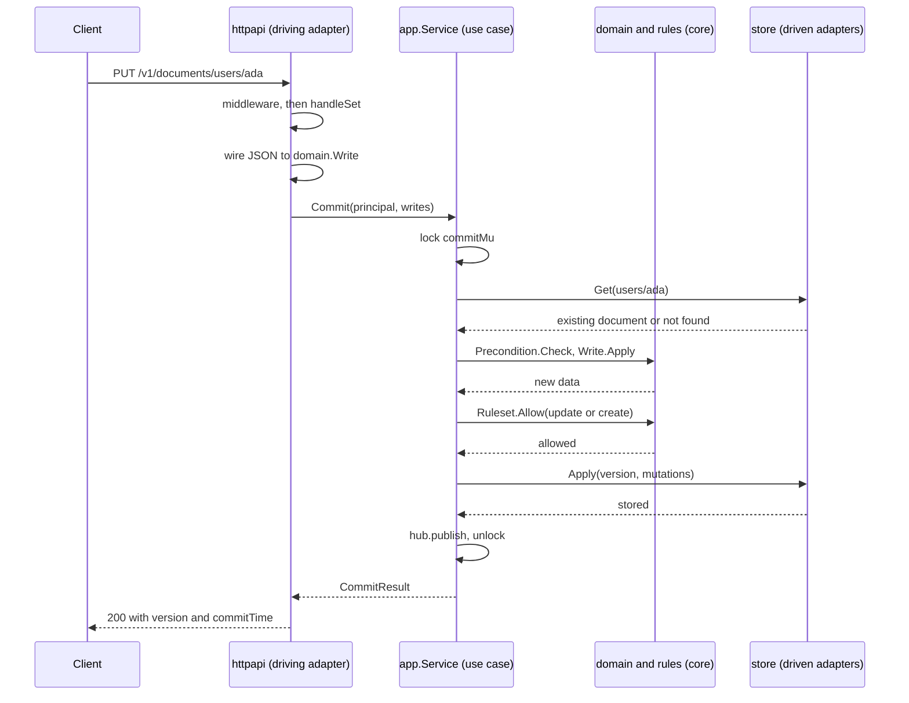
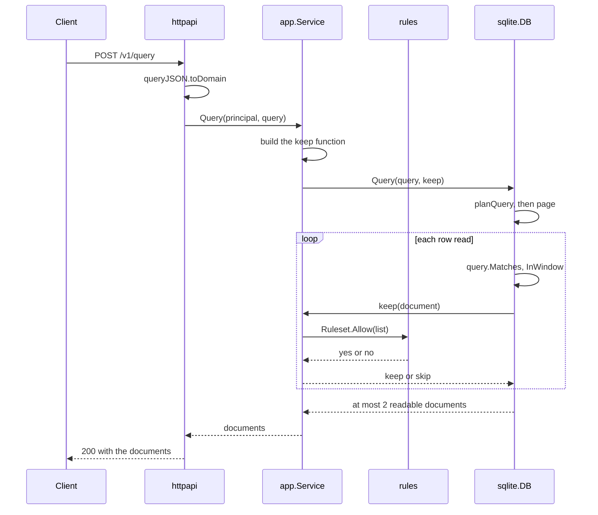
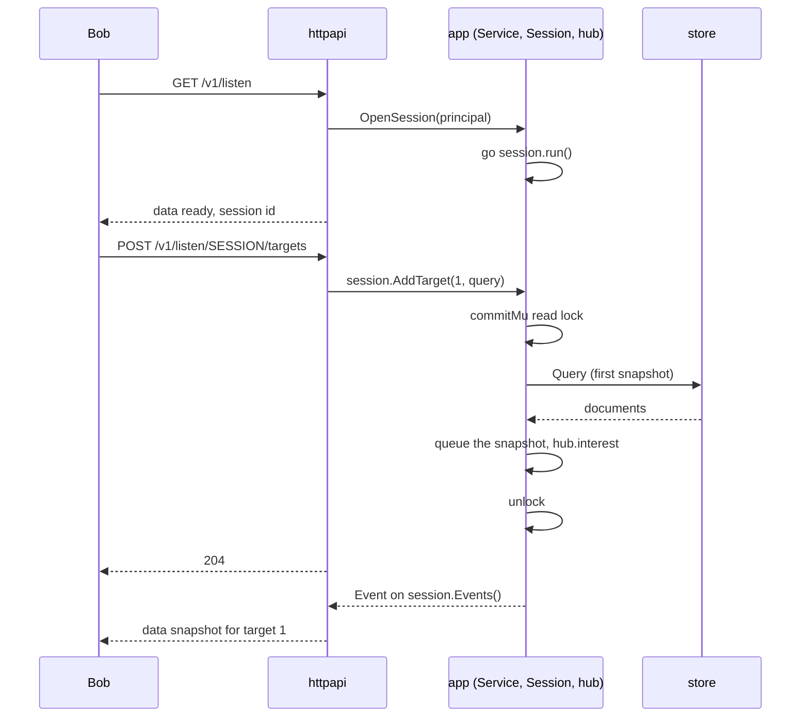
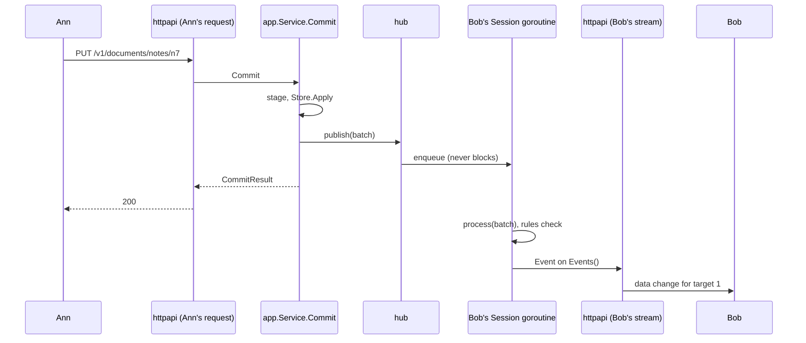

# Following a request through the layers

The [previous page](01-hexagonal.md) described the layers. This one follows
three real requests through them, function by function. Open the files as
you read; every name below is the real name in the source.

The three requests:

1. A write: `PUT /v1/documents/users/ada` with a bearer token.
2. A query: `POST /v1/query` while security rules are in force.
3. A change travelling from one client's write to another client's listen
   stream.

A convention used in the diagrams: the participants are the layers, from the
outside in. Arrows to the right are calls; dashed arrows to the left are
returns.

## 1. A write

```sh
curl -X PUT http://localhost:8090/v1/documents/users/ada \
  -H "Authorization: Bearer <access token>" \
  -d '{"name": "Ada", "visits": {"$increment": 1}}'
```



### In the driving adapter

The request first passes through the middleware, outermost first. The order
is fixed where the routes are built, in `routes` in
[`httpapi/server.go`](../../internal/adapters/httpapi/server.go):

```go
// Middleware wraps the mux from the inside out: the last one listed is
// the first to see a request.
return chain(mux,
	s.authenticate,
	s.limitBody,
	s.cors,
	s.observe,
	s.recoverPanics,
)
```

`chain` applies them so that the *last* one listed runs *first*. For this
request, in order of execution (all in
[`middleware.go`](../../internal/adapters/httpapi/middleware.go)):

1. **`recoverPanics`** installs a `defer` that would turn a panic further in
   into a 500 response.
2. **`observe`** picks or generates a request ID, wraps the
   `ResponseWriter` in a `statusRecorder`, and after the handler returns
   logs the request and counts its status.
3. **`cors`** adds the `Access-Control-Allow-Origin` header if the request
   has an `Origin`.
4. **`limitBody`** wraps the body in `http.MaxBytesReader`.
5. **`authenticate`** reads the `Authorization` header and calls
   `AuthService.Authenticate` in
   [`app/auth.go`](../../internal/app/auth.go). That first compares the
   token with the admin key, then calls the `TokenManager` port, which is
   `Manager.Verify` in
   [`jwtauth/jwt.go`](../../internal/adapters/jwtauth/jwt.go). The resulting
   `app.Principal` (user ID, claims, expiry) is stored in the request
   context. A bad token ends the request here with a 401.

Notice that even the middleware reaches the driven adapter (`jwtauth`) only
through the application and its port. The HTTP package never imports the JWT
package.

The standard library's `ServeMux` then matches the pattern
`PUT /v1/documents/{path...}` and calls **`handleSet`** in
[`documents.go`](../../internal/adapters/httpapi/documents.go):

```go
// handleSet is PUT /v1/documents/{path}: replace the document with the
// request body, or merge the body into it with ?merge=true.
func (s *Server) handleSet(w http.ResponseWriter, r *http.Request) {
	s.writeOne(w, r, writeRequest{Op: "set", Merge: r.URL.Query().Get("merge") == "true"})
}
```

`handleSet` only chooses the operation. **`writeOne`** reads the path from
the URL and the body into a `writeRequest`, and passes it to **`commit`**,
the one function every write endpoint ends in:

```go
// commit is the one place every write endpoint ends up: translate, call the
// use case, report the result.
func (s *Server) commit(w http.ResponseWriter, r *http.Request, requests []writeRequest, response commitJSON) {
	writes := make([]domain.Write, 0, len(requests))
	for i, wr := range requests {
		write, err := wr.toDomain()
		if err != nil {
			if len(requests) > 1 {
				err = fmt.Errorf("write %d: %w", i, err) // in a batch, say which write
			}
			s.writeError(w, r, err)
			return
		}
		writes = append(writes, write)
	}
	result, err := s.docs.Commit(r.Context(), principal(r.Context()), writes)
	if err != nil {
		s.writeError(w, r, err)
		return
	}
	response.Version = result.Version
	response.CommitTime = formatTime(result.Time)
	writeJSON(w, http.StatusOK, response)
}
```

This function is the driving adapter in miniature: translate in, call one
use case, translate out. The translation is `writeRequest.toDomain` in
[`wire.go`](../../internal/adapters/httpapi/wire.go), which:

- validates the path with `domain.ParseDocPath`;
- maps `"set"` to `domain.OpSet`;
- calls `parseWriteData`, which decodes the JSON and calls
  `liftTransforms`. That walks the object, finds
  `{"$increment": 1}` under `visits`, and moves it out of the data into a
  `domain.FieldOp` holding a `domain.Increment`.

The result is one `domain.Write`: operation `OpSet`, path `users/ada`, data
`{"name": "Ada"}`, and one field operation on `visits`. From here on nothing
knows that the request was JSON, or that it was HTTP.

### In the application

**`Service.Commit`** in [`app/write.go`](../../internal/app/write.go) is the
use case. In order:

1. It rejects an empty or oversized batch.
2. It takes `commitMu` exclusively. From here until it returns, no other
   commit runs (see [design decisions](03-design-decisions.md)).
3. It reads the time from the `Clock` port and computes the next version,
   `s.version + 1`.
4. For each write it loads the stored document with `s.load`, which calls
   `Store.Get` and turns "not found" into a nil pointer. Suppose
   `users/ada` already exists.
5. It calls **`Service.stage`**:

```go
func (s *Service) stage(ctx context.Context, p Principal, w domain.Write, existing *domain.Document, now time.Time, version int64) (*domain.Document, error) {
	if err := w.Pre.Check(existing); err != nil {
		return nil, err
	}
	if w.Op == domain.OpVerify {
		// Verifying reveals whether the document exists and at which
		// version, so it needs the same permission as reading it.
		if !s.allowedAt(ctx, p, rules.MethodGet, w.Path, existing, nil, now) {
			return nil, domain.ErrPermissionDenied
		}
		return existing, nil
	}
	data, err := w.Apply(existing, now)
	if err != nil {
		return nil, err
	}

	var updated *domain.Document
	method := rules.MethodDelete
	if data != nil {
		updated = &domain.Document{Path: w.Path, Data: data, CreateTime: now, UpdateTime: now, Version: version}
		method = rules.MethodCreate
		if existing != nil {
			updated.CreateTime = existing.CreateTime
			method = rules.MethodUpdate
		}
	}
	if !s.allowedAt(ctx, p, method, w.Path, existing, updated, now) {
		return nil, domain.ErrPermissionDenied
	}
	return updated, nil
```

`stage` is where the core is consulted, three times:

- **`Precondition.Check`** in
  [`domain/write.go`](../../internal/domain/write.go). This write has no
  precondition, so it passes.
- **`Write.Apply`** in the same file. It starts from the new data, then
  runs each field operation: `Increment.Apply` receives the previous value
  of `visits` (none, since `set` replaced the document) and returns `1`. It
  finally calls `ValidateData` for the size and depth limits. `Apply` is a
  pure function: document in, document out, no I/O.
- **`Service.allowed`** in
  [`app/service.go`](../../internal/app/service.go), with method `update`
  because a document existed. It builds a `rules.Request` and calls
  **`Ruleset.Allow`** in [`rules/eval.go`](../../internal/rules/eval.go).
  `Allow` walks the `match` blocks (`evaluator.walk`, `match.bind`), and for
  each `allow` statement that covers `update` evaluates the condition
  (`evaluator.holds`, `evaluator.eval`). If a rule calls `get(...)`, the
  evaluator calls back into `Service.load`, the function it was handed as
  `rules.Getter`.

If any of the three says no, `Commit` returns an error and nothing has been
stored. Otherwise:

6. `Commit` builds the list of `Mutation`s (final state per document) and
   calls **`Store.Apply`**.
7. It records the new version and calls **`hub.publish`** so listeners hear
   about the change (request 3 below).
8. The deferred unlock releases `commitMu`.

### In the driven adapters

`Store.Apply` is an interface call. In the running server the value behind
the interface is an `*instrumented.Store`, whose `Apply` in
[`instrumented/store.go`](../../internal/adapters/instrumented/store.go)
notes the start time and forwards to the store it wraps:

```go
func (s *Store) Apply(ctx context.Context, version int64, batch []app.Mutation) (err error) {
	defer func(start time.Time) { s.Applies.record(start, err) }(time.Now())
	return s.next.Apply(ctx, version, batch)
}
```

That wrapped store is the `*sqlite.DB`. Its **`Apply`** in
[`sqlite/store.go`](../../internal/adapters/sqlite/store.go) runs inside
`DB.inTx` (begin, commit or roll back) and, for our document:

1. deletes the document's old rows from the `idx` table;
2. inserts or replaces the row in `docs`, with the data as JSON;
3. calls `indexEntries` to list the index rows the document needs (one for
   `name`, one for `visits`) and inserts them, each key produced by
   `encodeKey` in [`keyenc.go`](../../internal/adapters/sqlite/keyenc.go);
4. stores the new version in the `meta` table.

All of it commits together or not at all.

### On the way back

`Commit` returns a `CommitResult`. Back in `commit` in the HTTP adapter, the
result is copied into a `commitJSON` and written with `writeJSON`. Had an
error come back instead, `writeError` in
[`errors.go`](../../internal/adapters/httpapi/errors.go) would call
`classify`, which uses `errors.Is` to map `domain.ErrPermissionDenied` to
403, `domain.ErrFailedPrecondition` to 412, and so on. The domain's error
categories are the vocabulary shared by all layers
([Go chapter 2](../go/02-errors.md)).

### What each layer contributed

| Layer | Knew about | Did not know about |
|---|---|---|
| `httpapi` | URLs, headers, JSON, status codes | SQL, rules syntax, locking |
| `app` | the order of steps, the lock, versions | JSON, HTTP, SQL |
| `domain`, `rules` | what a write means, what a rule allows | everything else |
| `sqlite` | tables, transactions, index keys | HTTP, rules, who the caller is |

## 2. A query under rules

```sh
curl -X POST http://localhost:8090/v1/query \
  -H "Authorization: Bearer <bob's token>" \
  -d '{"collection": "notes", "orderBy": [{"field": "created", "direction": "desc"}], "limit": 2}'
```

with these rules in force:

```text
match /notes/{id} {
  allow read: if resource.data.public == true || resource.data.owner == request.auth.uid;
}
```



### Adapter in

The middleware runs as before. **`handleQuery`** in
[`documents.go`](../../internal/adapters/httpapi/documents.go) decodes the
body into a `queryJSON` and calls **`queryJSON.toDomain`** in
[`wire.go`](../../internal/adapters/httpapi/wire.go), which parses the
collection path and field paths, turns `"desc"` into `Desc: true`, and ends
with `domain.Query.Validate`. The handler then calls `Service.Query`.

### Use case

**`Service.Query`** in [`app/read.go`](../../internal/app/read.go) validates
again (it cannot assume every caller is the HTTP adapter) and calls
`runQuery`. The interesting part of `runQuery` is this:

```go
var keep func(domain.Document) bool
if !p.Admin {
	keep = func(doc domain.Document) bool {
		return s.allowed(ctx, p, rules.MethodList, doc.Path, &doc, nil)
	}
}
docs, err := s.store.Query(ctx, q, keep)
```

`keep` is a closure: a function value that carries `s`, `ctx` and `p` with
it. The application hands it to the store, and the store calls it for every
candidate document. This is the application reaching *into* the adapter's
loop without the adapter knowing anything about rules. An admin caller gets
no `keep` at all.

### Driven adapter

**`DB.Query`** in [`sqlite/plan.go`](../../internal/adapters/sqlite/plan.go)
first calls **`planQuery`**. The query orders by one field, so the plan is:
scan the index of `created`, descending, and report `ordered: true`, which
means rows come out in final order and the scan may stop early.

Then the loop. **`DB.page`** asks `plan.statement` for the SQL, runs it on
the read pool, and decodes each row with `scanDoc`. For every document of
the page, `Query` applies the checks in this order:

```go
for _, doc := range docs {
	if !q.Matches(doc) {
		continue
	}
	if p.ordered && !q.BeforeEnd(doc) {
		break scan // in an ordered scan nothing later can qualify
	}
	if !q.InWindow(doc) || seen[doc.Path] {
		continue
	}
	if seen != nil {
		seen[doc.Path] = true
	}
	if keep != nil && !keep(doc) {
		continue
	}
	out = append(out, doc)
```

So for each note, newest first: does it match the query, is it inside the
cursor window, and then `keep(doc)`. That call crosses back into the
application: `Service.allowed` builds a `rules.Request` with method `list`
and the note as `resource`, and `Ruleset.Allow` evaluates the condition. A
private note of ann's returns false and is skipped. The loop continues until
two notes that bob may read have been collected, then stops.

Two details that the layering makes possible:

- The limit counts *readable* documents, because the rule check happens
  inside the scan and before the limit. Bob gets two notes if two exist that
  he may read, however many unreadable ones sort before them.
- Between pages the adapter holds no database connection. `keep` may itself
  read the database (a rule calling `get`), and holding one connection while
  waiting for another is how a pool deadlocks. The comment on `DB.Query`
  explains this; so does [design decisions](03-design-decisions.md).

### Adapter out

`handleQuery` converts each `domain.Document` with `toDocumentJSON` and
writes `{"documents": [...]}`.

The memory adapter answers the same call in three lines: copy the
collection's documents out under the lock, then `q.Apply(candidates, keep)`.
Same port, same results, no plan. That equivalence is tested
([testing strategy](04-testing-strategy.md)).

## 3. A write reaching another client's stream

Two clients. Bob has a listen stream open with one target: the query
"notes ordered by `created`". Ann writes a note. Follow the note to bob.

This walk-through has two parts, because bob's side was set up earlier.

### Part one: bob starts listening



1. **`handleListen`** in
   [`httpapi/listen.go`](../../internal/adapters/httpapi/listen.go) calls
   **`Service.OpenSession`** in
   [`app/listen.go`](../../internal/app/listen.go). That creates a
   `Session` with two channels (`queue` in, `events` out), registers it with
   the hub, and starts the session's goroutine with `go sess.run()`.
2. The handler writes the SSE headers and a `ready` message carrying the
   session ID, then enters its `select` loop, waiting on `sess.Events()`.
3. Bob's client posts the target. **`handleAddTarget`** finds the session
   with `Server.session` (which also checks that it belongs to bob),
   converts the body with `targetRequest.toDomain`, and calls
   **`Session.AddTarget`**.
4. `AddTarget` takes `commitMu` *shared*. No commit can run while it holds
   it. It runs the query through `runQuery` (rules included), builds the
   first `Event` with `Reset: true`, puts it on the session's queue, and
   calls `hub.interest` to record "this session cares about the collection
   `notes`". Then it releases the lock. Every commit is now either inside
   that snapshot or will be delivered after it.
5. `Session.run` takes the event from `queue` and sends it on `events`. The
   handler's `select` receives it, converts it with `toEventJSON`, and
   writes it to bob.

### Part two: ann writes



1. Ann's request runs exactly as in walk-through 1, up to the point where
   `Store.Apply` has succeeded.
2. `Commit` calls **`hub.publish`** with a `commitBatch`: the new version
   and, per document, the state before and after.

```go
func (h *hub) publish(b *commitBatch) {
	h.mu.Lock()
	interested := map[*Session]struct{}{}
	for _, c := range b.changes {
		for s := range h.byDoc[c.path] {
			interested[s] = struct{}{}
		}
		for s := range h.byCollection[c.path.Parent()] {
			interested[s] = struct{}{}
		}
	}
	h.mu.Unlock()

	for s := range interested {
		s.enqueue(queueItem{batch: b})
	}
}
```

   The hub looks up which sessions registered interest in the document's
   path or its parent collection. Bob's session is in
   `byCollection["notes"]`.
3. **`Session.enqueue`** puts the batch on bob's `queue` with a `select`
   that has a `default` case, so it returns at once whether or not there was
   room. If the queue is full, the session is closed instead. Ann's commit
   never waits for bob.
4. `Commit` returns and ann gets her 200. Bob has been told nothing yet. The
   two requests are now independent.
5. On bob's session goroutine, **`Session.run`** receives the batch and
   calls **`Session.process`**. For bob's target, a query without a limit,
   that means **`queryChanges`**:

```go
was := c.before != nil && q.Matches(*c.before) && q.InWindow(*c.before)
is := c.after != nil && q.Matches(*c.after) && q.InWindow(*c.after) &&
	s.mayRead(ctx, rules.MethodList, c.after)
switch {
case was && is:
	changes = append(changes, DocChange{ChangeModified, *c.after})
case is:
	changes = append(changes, DocChange{ChangeAdded, *c.after})
case was:
	changes = append(changes, DocChange{ChangeRemoved, domain.Document{Path: c.path}})
```

   `was` is false (the note is new). `is` asks the domain whether the note
   matches the query and the cursor window, and then asks the rules, with
   bob's principal, whether bob may list it. Suppose the note is public: the
   result is one `ChangeAdded`.
6. `process` wraps the changes in an `Event` with the commit's version, and
   `run` sends it on `events`.
7. In bob's `handleListen`, the `select` receives the event, `toEventJSON`
   converts it, and `send` writes `data: {...}` and flushes.

Had the note been private, step 5 would produce no change, but `process`
would still emit an event with an empty change list and the new version.
The comment on `process` explains why: the client SDK uses the version to
know when its own optimistic writes have been confirmed.

### Where the layers are in this flow

The whole realtime mechanism (hub, sessions, queues, snapshot consistency,
rules per listener) lives in `app`. The HTTP adapter's part is one loop that
moves events from a channel to a socket. That is why
[`app/listen_test.go`](../../internal/app/listen_test.go) can test all of it
without opening a network connection, and why a second transport would be a
small addition ([hexagonal](01-hexagonal.md), "A WebSocket transport").

The concurrency primitives used here (goroutines, channels, `select`,
`RWMutex`) are explained in [Go chapter 9](../go/09-concurrency.md). The
pattern is on the [observer](patterns/observer.md) page.

## Things to try

- Put a `logger.Debug` call at the top of `Service.Commit`, start the
  server with `-log-level debug`, and send the first request. Then add one
  in `sqlite.DB.Apply` and confirm the order.
- In `routes`, move `s.authenticate` to the end of the `chain` list and send
  a request with a bad token from a browser page on another origin. Which
  header is now missing from the 401, and why does the page's JavaScript no
  longer see the error body? (Undo the change afterwards.)
- Send the query of walk-through 2 with the admin key. Use a debugger or a
  log line to confirm that `keep` is nil and `Ruleset.Allow` is never
  called.

Next: [Design decisions](03-design-decisions.md)
