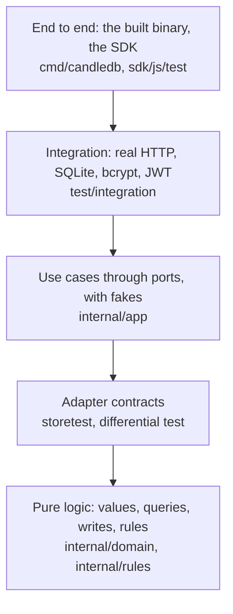

# Testing strategy

The architecture and the tests are two views of the same design. Each layer
of the hexagon can be tested at its own boundary, with exactly as much of
the real world as that layer touches. This page describes the layers of
tests that exist, what each is for, and what kind of mistake each one
catches that the others would miss.

How to write Go tests (tables, subtests, helpers, fuzzing) is the subject of
[Go chapter 3](../go/03-testing.md). This page is about *which* tests to
write *where*.

## The numbers

Measured on the code as it stands, with the commands shown.

```sh
go test ./...                      # everything
go test -v ./... | grep -c -- '--- PASS'
```

| Package | Test functions | Including subtests | Statement coverage of the package by its own tests |
|---|---|---|---|
| `internal/domain` | 19 | 88 | 89.3% |
| `internal/rules` | 10 | 127 | 87.4% |
| `internal/app` | 31 | 38 | 90.5% |
| `internal/adapters/memory` | 2 | 40 | 98.4% |
| `internal/adapters/sqlite` | 7 (and 4 benchmarks) | 52 | 92.7% |
| `internal/adapters/instrumented` | 2 | 38 | 95.0% |
| `internal/adapters/jwtauth` | 3 | 9 | 78.1% |
| `internal/adapters/bcrypthash` | 1 | 1 | 83.3% |
| `internal/adapters/httpapi` | 7 | 20 | 25.5% |
| `cmd/candledb` | 4 | 12 | 84.8% |
| `test/integration` | 24 | 44 | (see below) |
| **Total** | **110** | **about 470** | |

Two notes on reading the table.

The coverage column counts only statements reached by tests *in the same
package*. `httpapi` shows 25.5% because its own package holds only a few
unit tests; the handlers are exercised by `test/integration`, which is a
different package. Measured across packages the picture changes:

```sh
go test -short -coverpkg=./internal/...,./cmd/... -coverprofile=coverage.out ./...
go tool cover -func=coverage.out | tail -1
# total: (statements) 89.2%
```

So 89.2% of all statements in `internal/` and `cmd/` are executed by the
test suite as a whole (`make cover` runs this). The integration tests alone
reach 62% of them.

The second note: a coverage number says which lines ran, not which
behaviours were checked. The uncovered remainder here is mostly error
branches for failures that are hard to provoke (a failing disk, a failing
random source). The more useful question for each piece of code is the one
this page asks: which test would fail if this were wrong?

The JavaScript client adds 55 tests in six files under
[`sdk/js/test`](../../sdk/js/test), all against a real server process.

The whole Go suite runs in about half a minute with the race detector
(`go test -race ./...`), most of it in the randomised query test; without
it, a few seconds.

## The layers



The diagram is the usual test pyramid: many fast tests of small pieces at
the bottom, few slow tests of everything at the top. Read it bottom-up.

### 1. Pure domain tests

**Where:** [`internal/domain/*_test.go`](../../internal/domain),
[`internal/rules/rules_test.go`](../../internal/rules/rules_test.go).

**What they need:** nothing. No files, no network, no clock, no goroutines.
The functions under test take values and return values.

**What they are for.** This is where the meaning of the database is pinned
down: how values compare, what each query operator matches, what each write
operation and transform does to a document, what each rules expression
evaluates to. The tests are tables, and the tables read as a specification.
`TestExpressions` in the rules package has more than eighty rows of the form
"this expression, against this request, allows or denies".

**What they catch that nothing else would:** precise semantics at the edges.
That `age > 25` does not match a string. That `!=` requires the field to
exist. That `resource.data.missing == 1 || true` is true. An integration
test could check any one of these, but nobody would write hundreds of HTTP
requests to do it.

These tests exist because the domain is free of I/O. Had `Write.Apply`
taken a database handle, every row of its table would need a database.

### 2. Property tests

**Where:** `TestCompareIsATotalOrder` and `TestJSONRoundTrip` in
[`domain/value_test.go`](../../internal/domain/value_test.go);
`TestKeyEncodingPreservesOrder` in
[`sqlite/keyenc_test.go`](../../internal/adapters/sqlite/keyenc_test.go);
the generator in
[`domain/domaintest`](../../internal/domain/domaintest/random.go).

**What they are.** A table test checks chosen inputs. A property test
states a rule that must hold for *all* inputs and checks it on many
generated ones. Three rules are tested this way:

- `Compare` is a total order: reflexive, antisymmetric, transitive.
- Encoding a value as JSON and parsing it back gives an equal value.
- For any two values, the byte order of their index keys equals their
  `Compare` order.

**What they catch:** combinations nobody thought to write down. The
generator deliberately favours awkward values: zero and negative zero, 2^53
and its neighbours, the limits of `int64`, strings containing a zero byte,
empty containers. The third property is the one the whole index design
rests on, and it is checked on 160,000 pairs.

The generators use a fixed seed, so a failure is reproducible.

### 3. The storage contract

**Where:** [`internal/app/storetest`](../../internal/app/storetest/storetest.go),
called from the test files of `memory`, `sqlite` and `instrumented`.

**What it is.** An interface fixes method signatures. What the methods must
*do* is written in comments, and comments are not executed. `storetest.Run`
turns those comments into a test suite that takes the adapter as a
parameter:

```go
func TestStoreContract(t *testing.T) {
	storetest.Run(t, func(t *testing.T) app.Store { return openDB(t) })
}
```

The same eleven groups of checks therefore run against the in-memory store,
the SQLite store, and the instrumented wrapper around a store. A new adapter
gets its acceptance test for one line of code.

**What it catches:** differences between adapters. Does a rewritten document
leave a stale index entry behind? Does a collection named `users2` leak into
a query on `users`? Does the limit apply before or after the `keep` filter?
Is `2.0` still a double after storage? Does taking a refresh token work
exactly once when eight goroutines race for it?

This is the test layer that the ports-and-adapters design creates. The
application relies on the port's contract, the contract is tested once, and
every adapter is held to it. See
[ports and adapters](patterns/ports-and-adapters.md).

### 4. The differential query test

**Where:** `TestQueriesAgreeWithReference` in
[`sqlite/keyenc_test.go`](../../internal/adapters/sqlite/keyenc_test.go).

**What it is.** Two implementations answer the same question by different
routes. The memory store filters and sorts by brute force using
`domain.Query.Apply`, which is the definition of the right answer. The
SQLite store uses index plans, range scans and paging. The test loads both
with the same 250 random documents and runs 3,000 random queries (300 with
`-short`) through both, with random filters, orderings, limits, cursors and
sometimes a `keep` filter. The results must be identical, in order.

```go
want, err := reference.Query(ctx, q, keep)
if err != nil {
	t.Fatal(err)
}
got, err := db.Query(ctx, q, keep)
if err != nil {
	t.Fatalf("query %+v: %v", q, err)
}
if w, g := pathsOf(want), pathsOf(got); w != g {
	t.Fatalf("results differ for query %+v\n plan: %+v\n want: %s\n got:  %s", q, planQuery(q), w, g)
```

**What it catches:** planner bugs. A wrong range bound, a scan that stops
too early, a cursor applied in the wrong direction for a descending order.
These are exactly the bugs that hand-written cases miss, because the person
writing the cases has the same blind spots as the person writing the
planner.

The test also guards against its own emptiness: it fails if fewer than a
quarter of the random queries return any documents, since two stores
agreeing on "nothing" proves little. In the current run 1,292 of 3,000
queries return documents.

A reference implementation that is obviously correct, and a fast one checked
against it, is a technique worth remembering well beyond databases.

### 5. Use cases, through the ports, with fakes

**Where:** [`internal/app/*_test.go`](../../internal/app).

**What they need:** the real `domain` and `rules`, the in-memory store, and
small fakes for the other ports, defined in
[`helpers_test.go`](../../internal/app/helpers_test.go) and
[`auth_test.go`](../../internal/app/auth_test.go):

```go
// fakeClock is a Clock the test moves by hand. Because app only knows the
// Clock interface, tests can make an hour pass in a nanosecond instead of
// sleeping.
type fakeClock struct {
	mu  sync.Mutex
	now time.Time
}
```

| Port | In production | In these tests |
|---|---|---|
| `Store` | SQLite, instrumented | `memory.Store` |
| `UserStore` | SQLite | `memory.UserStore` |
| `Clock` | system clock | `fakeClock`, advanced by hand |
| `IDGenerator` | random | `sequentialIDs`: `id-1`, `id-2`, ... |
| `PasswordHasher` | bcrypt | `plainHasher`: instant, and counts calls |
| `TokenManager` | JWT | `fakeTokens`: readable text |

**What they are for.** The behaviour of the application as a whole, with the
slow and unpredictable parts replaced. A batch is atomic. A later write in a
batch sees an earlier one. A stale version fails the precondition. Rules are
consulted for each write with the right method. Twenty goroutines
incrementing a counter lose nothing. A listener's snapshot plus its changes
always add up to the store's final state. A slow listener is disconnected
and writers are not delayed. A refresh token works once.

**What the fakes make possible.** `TestRefreshRotatesTokens` makes two hours
pass by calling `clock.Advance(2 * time.Hour)`. `TestSignInFailuresLookAlike`
counts password verifications to prove that an unknown email costs the same
work as a wrong password, which with real bcrypt could only be guessed from
timing. Neither test is possible unless the clock and the hasher are ports.

This is the practical answer to "why bother with ports": not that SQLite
will be replaced one day, but that the application can be tested today, in
milliseconds, including its behaviour over time and under concurrency.

**What they do not prove:** that the real adapters behave like the fakes.
That is what layers 3 and 6 are for.

### 6. Integration tests with nothing faked

**Where:** [`test/integration`](../../test/integration).

**What they need:** everything real. `start` in
[`harness_test.go`](../../test/integration/harness_test.go) builds the same
object graph as `cmd/candledb`: a SQLite file in a temporary directory,
bcrypt (at its minimum cost, for speed), JWT signing, the instrumented
store, the full HTTP handler with all middleware, served by
`httptest.NewServer` on a real local port. Requests are real HTTP requests.

**What they are for.** The seams. Each component has passed its own tests;
these check that they are connected correctly. Does a token issued at
sign-up authenticate a request whose write the rules then judge using that
user's ID? Does a `412` come out when a precondition fails three layers
down? Does the SSE stream deliver a change, end when its token expires, end
when the server shuts down, and release its session when the client
disconnects? Is the CORS header present on an error response? Does the data,
including indexes and accounts, survive closing the database and opening it
again?

**What they catch that unit tests cannot:** wiring mistakes and wire-format
mistakes. A middleware in the wrong order. A status code mapped from the
wrong error. A JSON field named `commit_time` in one place and `commitTime`
in another. A large integer that loses precision on the way out.

They are slower (the package takes a few seconds) and when one fails it
says less about where the fault is. That is why there are 24 of them and
not 240, and why the precise behaviour is tested lower down.

### 7. End to end

**Where:** `TestServeEndToEnd` in
[`cmd/candledb/main_test.go`](../../cmd/candledb/main_test.go), and the
client's tests in [`sdk/js/test`](../../sdk/js/test).

`TestServeEndToEnd` calls the same `run` function as `main` with real
arguments. It starts the server on a free port with a rules file on disk,
checks that the rules are enforced, rewrites the file and sends itself
`SIGHUP` to check the reload, checks that a broken rules file is refused
while the old rules stay in force, takes a backup while serving, shuts down
with a listen stream open, and finally starts a second server on the backup
and reads the data back. It covers what only exists in `cmd/candledb`:
flags, files, signals, shutdown order.

The SDK's tests go one step further out: a separate process (the compiled
binary), a separate language, a real network socket. They are the only
tests of the client's own logic (ordering, optimistic writes, reconnection
after the server is killed and restarted), and they are also a second,
independent check of the server's wire protocol, written against the
protocol and not against the Go types.

### 8. Fuzzing

**Where:** `FuzzParse` in
[`rules/rules_test.go`](../../internal/rules/rules_test.go).

The rules parser reads text written by people, and a parser that panics on
strange input takes the server down at start-up or reload. The fuzz target
feeds it arbitrary strings, and evaluates whatever parses. In normal test
runs only the seed inputs run; `make fuzz` (or CI, for thirty seconds) lets
Go mutate them, guided by coverage, looking for a crash or a hang.

**What it catches:** inputs no human would type. Unterminated everything,
nesting hundreds deep, a wildcard that never closes.

## Which layer for which question

| If you change... | The first test to fail should be in... |
|---|---|
| how two values compare | `domain` (table and property tests), then `sqlite` (key order) |
| what a query operator matches | `domain`, then the storage contract |
| the SQLite query planner | the differential test |
| the order of steps in a commit | `app` |
| locking or the listener hub | `app`, under `-race` |
| a rules built-in | `rules` |
| a route, a status code, a JSON field name | `test/integration` and the SDK tests |
| a flag or the shutdown sequence | `cmd/candledb` |
| what a person sees in the example app | `test/browser` |
| a link or a heading in these documents | `test/docs` |
| the container image | `make docker-smoke` |
| the contents of the npm package | `make sdk-pack` |

The last four are not about Go code at all; they and the rest of the
automated checks are described in
[Go chapter 11](../go/11-continuous-integration.md).

If a bug is found and no test in the right row failed, the fix has two
parts: the code, and a test at the lowest layer that could have caught it.

## What the tests do not cover

Being exact about the gaps is part of the strategy.

- **Crash safety.** No test kills the process mid-commit and checks the
  file. The atomicity of `Apply` rests on SQLite's transactions.
- **Scale.** The largest data set in a test is 50,000 documents, in a
  benchmark. Behaviour with millions of documents or thousands of listeners
  is unmeasured.
- **Time on the real clock.** Token expiry on the stream is tested with a
  two-second token; nothing runs for hours.
- **Phones and old browsers.** The example app is tested in the current
  desktop versions of Chromium, Firefox and WebKit
  ([`test/browser`](../../test/browser)), and nowhere else.
- **Other operating systems, locally.** The tests run on Linux, macOS and
  Windows in CI ([Go chapter 11](../go/11-continuous-integration.md)), and
  were developed on Linux only.

## Things to try

- Break something on purpose and see which test notices. In
  [`sqlite/plan.go`](../../internal/adapters/sqlite/plan.go), change
  `ordered: len(q.Orders) == 1` to `ordered: true` and run
  `go test ./internal/adapters/sqlite`. Read the failure message: it prints
  the query, the plan and both results.
- In [`app/write.go`](../../internal/app/write.go), move the
  `s.hub.publish` call to before `s.store.Apply`. Which tests fail, and
  which do not? What does that tell you about a missing test?
- Write a new adapter test file for `memory` that passes a store with a
  deliberate bug (wrap `memory.Store` and make `Query` ignore `keep`) to
  `storetest.Run`, and confirm the contract catches it.

Next: [Patterns](patterns/README.md)
