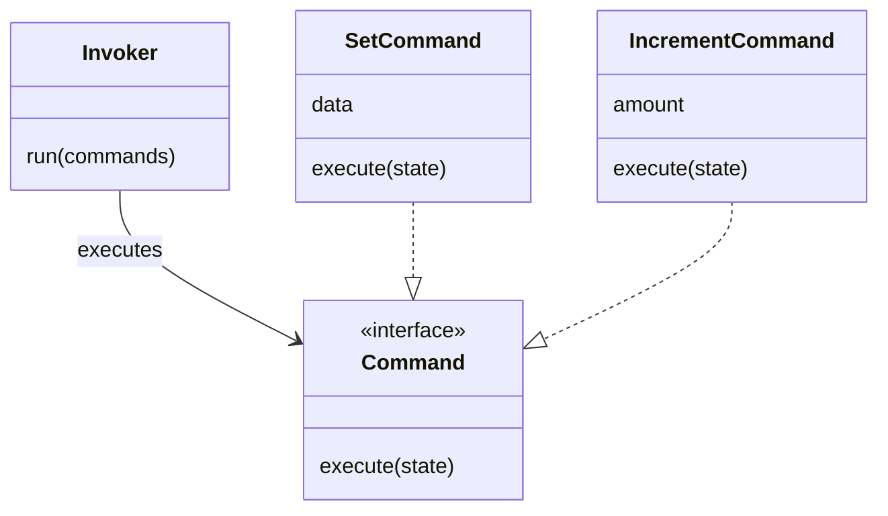
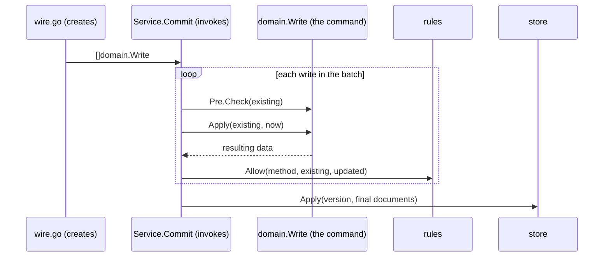

# Command

## The problem

A client wants to change a document. The simplest server would do it on the
spot: the handler for "set" overwrites the row, the handler for "update"
reads the row, changes some fields and writes it back.

That falls apart as soon as the requirements are listed:

- **Batches.** Several changes must take effect together or not at all. The
  second change cannot already have been executed when the third turns out
  to be forbidden.
- **Authorisation needs the outcome.** A rule such as
  `request.resource.data.owner == request.auth.uid` judges the document *as
  it would be* after the write. The server must be able to compute the
  result without storing it.
- **Validation needs the outcome too.** The size limit applies to the
  resulting document, not to the request.
- **Server-side values.** "Increment `visits` by one" and "set `updated` to
  the server's time" cannot be turned into plain values by the client; the
  client does not know the current count or the commit time.
- **Several ways in.** `PUT`, `PATCH`, `POST`, `DELETE` and `/v1/commit`
  must all behave identically.
- **Optimistic display.** The client SDK wants to show the effect of a
  write before the server has answered.

Every one of these needs the same thing: the change must exist as a *thing*
that can be passed around, inspected, and applied to a document on demand,
separately from the act of storing.

## The pattern

The command pattern turns a request to do something into an object. The
object carries everything needed to carry the request out. Whoever creates
the command (the **client**) need not be the one who executes it (the
**invoker**), and the execution can be delayed, queued, logged, repeated or
refused.



The essential move is separating *describing* a change from *performing*
it.

## In candledb

There are two levels of command, both in
[`internal/domain/write.go`](../../../internal/domain/write.go).

### The document-level command: `Write`

```go
// Write is one requested change to one document. It is a value describing
// the change, separate from the code that carries it out, so that a batch of
// writes can be validated, authorised and applied as a unit.
type Write struct {
	Op   WriteOp
	Path DocPath
	// Data is the new content for OpSet and OpCreate.
	Data Map
	// Fields are applied in order on top of Data (OpSet, OpCreate) or on top
	// of the stored document (OpMerge, OpUpdate).
	Fields []FieldOp
	// Pre is checked against the stored document before the write applies.
	Pre Precondition
}
```

A `Write` is plain data: which operation, which document, what content,
which field operations, on what condition. It has no reference to a
database or a request. The comment states the purpose: "a value describing
the change, separate from the code that carries it out".

Its "execute" method is `Apply`:

```go
// Apply computes the document data that results from this write.
//
// existing is the stored document, or nil. The returned map is nil when the
// write deletes the document (or, for OpVerify, when there is none). Apply
// never modifies existing: the result shares the parts that did not change.
func (w Write) Apply(existing *Document, now time.Time) (Map, error) {
```

`Apply` takes the stored document and returns the data that would result.
It does not store anything. It is a pure function, which is why
[`write_test.go`](../../../internal/domain/write_test.go) can check every
operation with a table and no database.

### The field-level command: `Transform`

Inside a write, each change to a single field is itself a command:

```go
// Transform computes the new value of a field from its previous value. Each
// implementation is a small command object: the data it needs travels with
// it and Apply carries it out.
type Transform interface {
	// Apply returns the new value. prev is nil when the field does not
	// exist. Returning remove=true deletes the field.
	Apply(prev Value, now time.Time) (v Value, remove bool)
}
```

There are six implementations: `SetValue`, `DeleteField`,
`ServerTimestamp`, `Increment`, `ArrayUnion`, `ArrayRemove`. Each is a tiny
struct holding its parameters, with an `Apply` that carries it out:

```go
func (t ArrayUnion) Apply(prev Value, _ time.Time) (Value, bool) {
	old, _ := prev.(Array)
	out := make(Array, len(old), len(old)+len(t.Elements))
	copy(out, old)
	for _, e := range t.Elements {
		if !out.Contains(e) {
			out = append(out, e)
		}
	}
	return out, false
}
```

`ServerTimestamp` shows why execution must be deferred. The client cannot
supply the value. It sends the *instruction*, and the server executes it at
commit time with the commit's `now`:

```go
func (ServerTimestamp) Apply(_ Value, now time.Time) (Value, bool) { return NewTimestamp(now), false }
```

`Write.Apply` runs a write's field operations in order, each against the
document as the previous ones left it:

```go
prev, _ := data.Get(f.Path)
v, remove := f.Transform.Apply(prev, now)
if remove {
	data = data.Without(f.Path)
} else {
	data = data.With(f.Path, v)
```

So there is a small composite here as well: a `Write` is a command made of
`FieldOp` commands, and a commit is a list of `Write` commands.

### The life of a command

Follow one write from request to disk and count how many times it is
handled as data before anything is stored.



1. **Created** in the HTTP adapter. `writeRequest.toDomain` in
   [`httpapi/wire.go`](../../../internal/adapters/httpapi/wire.go) builds a
   `domain.Write` from JSON. The wire form `{"$increment": 1}` becomes
   `domain.Increment{By: domain.Int(1)}` in `parseTransform`. All five
   write endpoints produce the same type, which is how they come to behave
   identically.
2. **Collected.** `Service.Commit` in
   [`app/write.go`](../../../internal/app/write.go) receives a slice of
   them. Nothing has happened yet; an oversized batch is refused here.
3. **Checked.** `w.Pre.Check(existing)`.
4. **Executed against a copy of reality.** `w.Apply(existing, now)` gives
   the would-be document. Later writes in the batch see the results of
   earlier ones through the `staged` map.
5. **Judged.** The rules see both `existing` and the would-be document.
6. **Either discarded or stored.** If any write in the batch fails any
   check, `Commit` returns and the would-be documents are simply dropped;
   there is nothing to undo, because nothing was done. Otherwise the final
   documents go to `Store.Apply` in one transaction.

Step 6 is the pay-off. Atomic batches would normally need undo logic. Here
"rollback" is free: commands are executed on values in memory, and only the
finished result is written.

Note what reaches the store: not commands, but `app.Mutation`s, the final
state of each document. The store never sees an `Increment`. Commands exist
between the adapter and the use case; below the use case there is only
state.

### The same commands, replayed in the client

Describing a change as data has one more consumer. The JavaScript client
keeps each write it has sent, in its wire form, until the server confirms
it, and applies those pending writes on top of the server's data to produce
what a listener shows. That is how a new todo appears at once with
`hasPendingWrites: true`.
[`sdk/js/src/mutations.ts`](../../../sdk/js/src/mutations.ts) has the
client-side counterpart of `Write.Apply`:

```ts
export function applyLocally(existing: WireDoc | undefined, w: WireWrite, now: Date): WireDoc | undefined {
  let data: WireMap;
  switch (w.op) {
    case "delete":
      return undefined;
```

The client's version estimates what the server will compute (the local
clock for a server timestamp, local addition for an increment). When the
server's answer arrives, the pending command is dropped and the real result
replaces the estimate. If the server refuses the write, the command is
dropped and the view returns to the server's state. This replay-and-discard
is only possible because a write is a value that can be kept and applied
again.

## What Go changes

- **A command is often just a struct.** The classic pattern gives every
  command an `Execute()` method and its own class. `Write` is one struct
  with an `Op` field and a `switch`, because the five operations share
  nearly everything. Go does not push you towards a type per variant.
- **Where behaviour does differ per variant, small types and a one-method
  interface are cheap.** `Transform` has six implementations of a few lines
  each. Three of them are one-liners written on a single line each.
- **Value semantics help.** A `Write` is passed and stored by value. The
  data it refers to is immutable by convention (`Map.With` copies along the
  path and shares the rest), so applying a command never damages the stored
  document it started from. `TestWriteApply` checks this for every case.
- **No undo method.** Classic command objects often carry `undo()`. With
  immutable inputs, the previous state is still there; nothing needs
  undoing.

## Costs and when not to use it

- **Two representations of every operation.** There is the wire form
  (`{"op": "update", "data": {...}}`), the command (`domain.Write`), and in
  the client a third. Each translation is code and a place for mismatch.
  The `liftTransforms` function in `wire.go` is the least obvious code in
  the HTTP adapter.
- **Indirection for simple cases.** A single `set` goes through the same
  staging machinery as a 500-write batch.
- **Client and server must agree on what a command means.** The client's
  `applyLocally` is a second implementation of `Write.Apply` in another
  language. They are kept honest only by the SDK's tests against the real
  server.
- **Deferred execution hides failures until later.** A command that looks
  fine when created (an `update` of a document) fails only when applied
  (the document is gone).

Do not make commands out of operations that are always executed
immediately, one at a time, by the code that creates them. `Service.Get`
takes a path and returns a document; wrapping that in a `GetCommand` would
add a type and remove nothing. The pattern earns its keep when something
happens *between* description and execution: here, batching, checking,
authorising and replaying.

## Questions to check your understanding

1. A batch contains `create c/doc {"n": 1}` followed by
   `update c/doc {"n": {"$increment": 5}}`. The document did not exist
   before the batch. Why does the update not fail with "not found"?
2. `Increment.Apply` receives `prev`. For a `set` (not merge) of
   `{"visits": {"$increment": 1}}` on a document whose `visits` is 41, what
   is the result, and why?
3. The store port's `Apply` receives `[]app.Mutation`, not
   `[]domain.Write`. Name one thing that would become harder, and one that
   would become possible, if the store received the writes instead.
4. Where is the decision made that a write is a "create" or an "update" for
   the purpose of security rules? Why can it not be made when the command is
   created?
5. `OpVerify` changes nothing. Why is it a `Write` at all, instead of a
   separate parameter of `Commit`?

<details>
<summary>Answers</summary>

1. `Service.Commit` keeps a `staged` map of documents as the batch has
   changed them so far. For the second write, `existing` comes from
   `staged`, where the first write put the created document, so
   `Write.Apply` for `OpUpdate` finds a document. The test
   `TestLaterWritesInABatchSeeEarlierOnes` covers this.
2. The result is 1. For `OpSet`, `Write.Apply` starts from the write's own
   data, which does not contain `visits` (the transform was lifted out of
   it). The field operation then runs against that working document, so
   `prev` is nil and `Increment` returns its operand. To add to the stored
   value, use an update or a merge, which start from the stored data.
3. Harder: every adapter would have to implement the semantics of every
   operation and transform, and they would have to agree; today that logic
   exists once, in the domain. Possible: an adapter could execute some
   operations inside the database (an atomic SQL increment) without the
   read-compute-write cycle, which matters if writes were not already
   serialised by the commit lock.
4. In `Service.stage`: the method is `create` if no document existed,
   `update` if one did, `delete` if the result is nil. It depends on the
   stored state at commit time, which the creator of the command (the HTTP
   adapter) does not know. A `PUT` is a create or an update depending on
   what is there.
5. Because it must take part in everything a write takes part in: it has a
   path and a precondition, it must be checked in the same atomic step as
   the batch's real writes, it is subject to rules (it needs `get`
   permission), and listeners of that document should learn the commit's
   version. Making it one more operation of the existing command reuses all
   of that; a separate parameter would need its own copy of each.

</details>

## Try it

**Add a `Multiply` transform.**

Goal: `{"price": {"$multiply": 1.1}}` in an update multiplies a numeric
field. A missing or non-numeric field becomes 0.

1. `domain/write.go`: add `type Multiply struct{ By Value }` and its
   `Apply`, next to `Increment`. Decide what an integer times an integer
   gives, and an integer times a double.
2. `domain/write_test.go`: add cases to `TestWriteApply`.
3. `httpapi/wire.go`: add the key `$multiply` to the constants and to
   `parseTransform`, with the same validation as `$increment`.
4. `httpapi/internal_test.go`: add a case to `TestWriteTranslation`.

How to verify: `go test ./internal/domain ./internal/adapters/httpapi`
passes, and a `curl` against a running server shows the multiplied value.

Then notice what you did *not* touch: `Service.Commit`, the rules engine,
both storage adapters, the listener hub. A new kind of change went through
the whole system by adding one command type and its wire spelling. And
notice what is now out of step: the JavaScript client's `applyLocally` does
not know `$multiply`. What would a listener show while such a write is
pending?

Next: [Functional options](functional-options.md)
