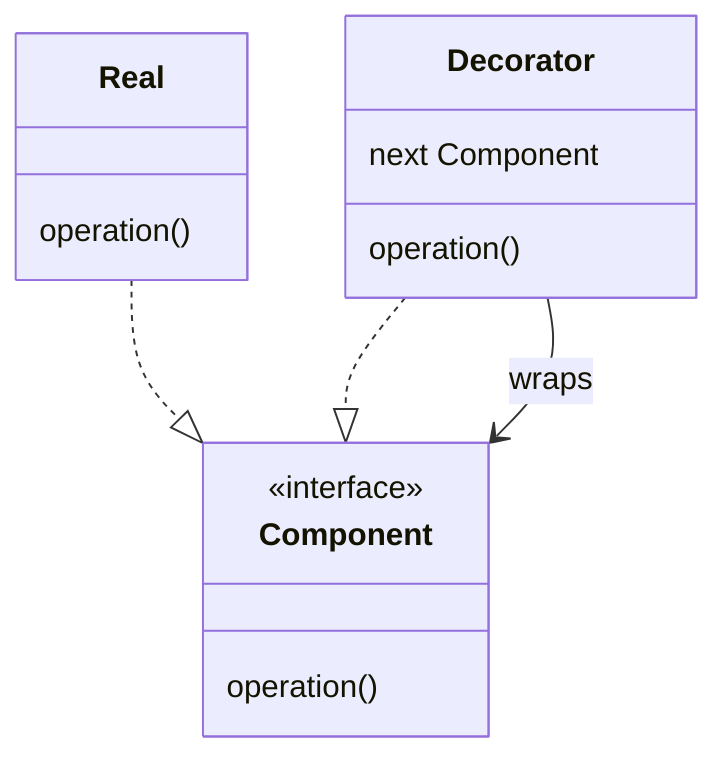

# Decorator

## The problem

Some things must happen for every request, whichever handler serves it:

- recover from a panic and answer 500;
- assign a request ID, log the request, count its status;
- answer CORS preflights and add CORS headers;
- cap the size of the body;
- turn the bearer token into a principal.

There are eighteen routes. Writing these five steps at the top of eighteen
handlers means ninety places to get wrong, and the handler for a new route
will forget one. The steps also have nothing to do with what any handler is
*for*.

The same problem appears once more on the storage side: the operator wants
to know how many store calls are made, how long they take and how many
fail. Adding timing code to every method of the SQLite adapter would mix
measurement into storage, and the memory adapter would then need the same
code again.

## The pattern

A decorator is an object that wraps another object of the same interface.
It receives each call, may do something before, forwards the call to the
wrapped object, and may do something after. To its caller it is
indistinguishable from the thing it wraps.



Because the wrapper has the same interface as what it wraps, wrappers can
be stacked, each adding one concern, in any number:


Neither the caller nor the real object changes when a decorator is added or
removed. The stack is assembled in one place.

## In candledb

### HTTP middleware

In Go's `net/http`, the component interface is `http.Handler`, which has
one method, `ServeHTTP`. A decorator for handlers is conventionally called
**middleware**.
[`internal/adapters/httpapi/middleware.go`](../../../internal/adapters/httpapi/middleware.go)
gives the shape a name:

```go
// middleware is a function that wraps a handler to add behaviour around it.
// This is the decorator pattern applied to http.Handler: each middleware
// returns something with the same interface as what it was given.
type middleware func(http.Handler) http.Handler

// chain applies middleware so that the first one listed is closest to the
// handler and the last one is outermost.
func chain(h http.Handler, mws ...middleware) http.Handler {
	for _, mw := range mws {
		h = mw(h)
	}
	return h
}
```

A middleware is a function from handler to handler. The simplest one in the
file:

```go
// limitBody caps the size of request bodies. Reading past the cap fails
// with *http.MaxBytesError, which classify maps to 413.
func (s *Server) limitBody(next http.Handler) http.Handler {
	return http.HandlerFunc(func(w http.ResponseWriter, r *http.Request) {
		r.Body = http.MaxBytesReader(w, r.Body, s.maxBodyBytes)
		next.ServeHTTP(w, r)
	})
}
```

Read its structure, because all five have it:

- It takes `next`, the handler to wrap.
- It returns a new handler (an `http.HandlerFunc` made from a closure).
- Inside, it does its work, then calls `next.ServeHTTP(w, r)`.

What varies is where the work sits relative to that call:

| Middleware | Before `next` | After `next` | May skip `next` |
|---|---|---|---|
| `recoverPanics` | installs a `defer` | the deferred function handles a panic | no |
| `observe` | request ID, start time, wraps the writer | logs, counts the status | no |
| `cors` | adds headers | nothing | yes: answers a preflight itself |
| `limitBody` | wraps the body | nothing | no |
| `authenticate` | verifies the token, stores the principal | nothing | yes: answers 401 |
| `rateLimit` | spends a token | nothing | yes: answers 429 |

A middleware that does not call `next` ends the request. That is how
`authenticate` rejects a bad token before any handler runs.

### Order matters

The stack is built in `routes` in
[`server.go`](../../../internal/adapters/httpapi/server.go):

```go
return chain(mux,
	s.authenticate,
	s.limitBody,
	s.cors,
	s.observe,
	s.recoverPanics,
)
```

The first listed is innermost. A request passes through them in the reverse
of the listed order, and the response comes back out in the listed order:


Each position is a decision:

- **`recoverPanics` is outermost** so that a panic in any other middleware
  is caught too.
- **`observe` is next** so that every request is logged and counted,
  including ones that `cors` or `authenticate` answer themselves.
- **`cors` is outside `authenticate`** so that a 401 still carries the
  `Access-Control-Allow-Origin` header. Without it a browser would hide the
  error response from the page's JavaScript, and the client could not tell
  an expired token from a network failure. The integration test `TestCORS`
  checks an error response for exactly this.
- **`authenticate` is innermost** so that handlers always find a principal
  in the context.

`rateLimit` is not in the global stack. It decorates only the three
credential endpoints, at the route:

```go
limited := s.rateLimit(s.authLimiter)
mux.Handle("POST /v1/auth/signup", limited(http.HandlerFunc(s.handleSignUp)))
mux.Handle("POST /v1/auth/signin", limited(http.HandlerFunc(s.handleSignIn)))
mux.Handle("POST /v1/auth/refresh", limited(http.HandlerFunc(s.handleRefresh)))
```

Decorators compose at any granularity: all routes, a group, or one.

### Decorating the response writer, and `Unwrap`

`observe` needs to know the status code the handler wrote, which
`http.ResponseWriter` does not expose. So it decorates the writer as well:

```go
// statusRecorder remembers the status code a handler wrote.
type statusRecorder struct {
	http.ResponseWriter
	status int
}
```

Embedding `http.ResponseWriter` gives `statusRecorder` all of its methods
for free; only `WriteHeader` and `Write` are overridden to take a note
first.

Here the pattern shows a real weakness. The underlying writer can do more
than the `ResponseWriter` interface says: it can flush buffered data and
set deadlines, which the listen stream depends on. A wrapper hides those
abilities, because the wrapper's type has only the methods it declares.
The fix:

```go
// Unwrap lets http.ResponseController reach the real writer, which is how
// the listen handler can still flush and set deadlines through this wrapper.
func (r *statusRecorder) Unwrap() http.ResponseWriter { return r.ResponseWriter }
```

`http.ResponseController` looks for an `Unwrap` method and follows it down
the stack until it finds a writer that supports the operation. Without this
one line, `handleListen` would fail to flush, and the realtime stream would
deliver nothing until its buffer filled. Any decorator over an interface
whose implementations have optional extra abilities needs an answer to this
problem.

### The instrumented store

The second decorator wraps the storage port.
[`internal/adapters/instrumented/store.go`](../../../internal/adapters/instrumented/store.go):

```go
// Store is an app.Store that records statistics about another one.
type Store struct {
	next app.Store

	Gets    OpStats
	Queries OpStats
	Applies OpStats
}
```

It has a `next app.Store` and three sets of counters. Each method forwards
and records:

```go
func (s *Store) Query(ctx context.Context, q domain.Query, keep func(domain.Document) bool) (docs []domain.Document, err error) {
	defer func(start time.Time) { s.Queries.record(start, err) }(time.Now())
	return s.next.Query(ctx, q, keep)
}
```

The `defer` with an immediately supplied `time.Now()` is a compact way to
say "note the start now, record at the end, whatever the outcome". The
named result `err` is what lets the deferred function see the error.

It is slotted in at the composition root with one call,
`store := instrumented.Wrap(db)`, and the application receives `store`
without knowing it is not the database itself. The tests confirm the
decorator is transparent by running the whole storage contract through it
(`TestWrappedStoreHonoursContract`).

One judgement is encoded in `Get`: "not found" is counted as a call but not
as an error, because a missing document is an ordinary answer. A decorator
that measures has to understand a little of what it measures.

## What Go changes

- **A function type can implement an interface.** `http.HandlerFunc` is a
  function type with a `ServeHTTP` method, so a closure becomes a handler
  without declaring a struct. The classic decorator needs a class per
  decorator; HTTP middleware needs a function per decorator.
- **Closures hold the wrapped object.** `next` is simply a captured
  variable.
- **Embedding gives forwarding for free.** `statusRecorder` embeds the
  writer and overrides two methods. In the classic pattern every method of
  the interface must be forwarded by hand; `instrumented.Store` does that
  for its five methods because it wants to time most of them.
- **Embedding does not solve the optional-interface problem.** Hence
  `Unwrap`, a convention the standard library also uses for errors
  (`errors.Unwrap`).

## Costs and when not to use it

- **Hidden behaviour.** Reading `handleGet` tells you nothing about
  authentication. You must know to look at `routes`. A stack of fifteen
  middlewares is its own kind of unreadable.
- **Order is implicit and important**, and the compiler checks none of it.
  The comments on `routes` and the tests are the only guard.
- **Communication through context.** `authenticate` passes the principal to
  handlers through `context.WithValue`, which is untyped at the point of
  use. The file contains the damage with a private key type and one typed
  accessor (`principal(ctx)`), but a handler that runs without the
  middleware silently gets an anonymous principal.
- **Stack traces and debugging get deeper.**

Do not use a decorator for logic that belongs to one operation. The
precondition check of a write is part of committing, so it is in `Commit`,
not in a wrapper around it. A useful test: could this wrapper be removed
without changing what the system is *for*? Logging, metrics, panic
recovery: yes. Authorisation by security rules: no, which is why rules are
checked inside the use case and not in middleware.

## Questions to check your understanding

1. If `s.observe` and `s.recoverPanics` swapped places in the `chain` call,
   what would be lost when a handler panics?
2. A request arrives with `Authorization: Bearer garbage` for `/healthz`.
   Which middlewares run, which handler runs, and what is the status?
3. Why does `statusRecorder.Write` set `status` to 200 when it is still
   zero?
4. `instrumented.Store.Version` and `Close` do not record anything. Is the
   type still a correct decorator?
5. The rate limiter is applied as `limited(http.HandlerFunc(s.handleSignUp))`.
   Why is the conversion to `http.HandlerFunc` needed there but not in
   `mux.HandleFunc("GET /v1/auth/me", s.handleMe)`?

<details>
<summary>Answers</summary>

1. `observe` would be outermost. When a handler panicked, `recoverPanics`
   (now inside) would still write the 500, so `observe` would log and count
   it. What changes is a panic inside `observe` itself or its logger: with
   the current order `recoverPanics` catches it; swapped, nothing would, and
   `net/http` would drop the connection. The outermost position is for the
   one middleware that protects all the others.
2. `recoverPanics`, `observe`, `cors`, `limitBody` and `authenticate` run in
   that order. `authenticate` fails to verify the token, writes a 401 and
   does not call `next`, so no handler runs. `observe` then logs status 401.
   The global `authenticate` applies to every route, health check included.
3. A handler may call `Write` without calling `WriteHeader` first; `net/http`
   then sends 200 implicitly. The recorder mirrors that rule so that such a
   response is logged as 200 and not as 0.
4. Yes. A decorator must preserve the wrapped object's behaviour; it is
   free to add its extra behaviour to only some operations. Both methods
   forward faithfully.
5. `limited` is a `middleware`, a function that takes an `http.Handler`.
   `s.handleSignUp` is a plain function, which is not an `http.Handler`
   until converted to `http.HandlerFunc` (the type that has the
   `ServeHTTP` method). `mux.HandleFunc` takes a plain function and does the
   same conversion internally.

</details>

## Try it

**Add a middleware that sets security headers.**

Goal: every response carries `X-Content-Type-Options: nosniff`.

1. Write `func (s *Server) secureHeaders(next http.Handler) http.Handler` in
   `middleware.go`, modelled on `limitBody`.
2. Add it to the `chain` call in `routes`. Decide where: must the header be
   present on a 401 from `authenticate`? On a 500 from `recoverPanics`?
3. Add an assertion to an existing test in `test/integration/ops_test.go`
   that checks the header on a successful response and on an error
   response.

How to verify: `go test ./test/integration` passes. Then move your
middleware to the innermost position, run the test again, and explain the
failure (or its absence) to yourself.

A second exercise on the storage side: write a `readonly` decorator for
`app.Store` whose `Apply` always returns an error wrapping
`domain.ErrUnavailable` and whose other methods forward. Run
`storetest.Run` against it and predict which cases fail before you look.

Next: [Command](command.md)
