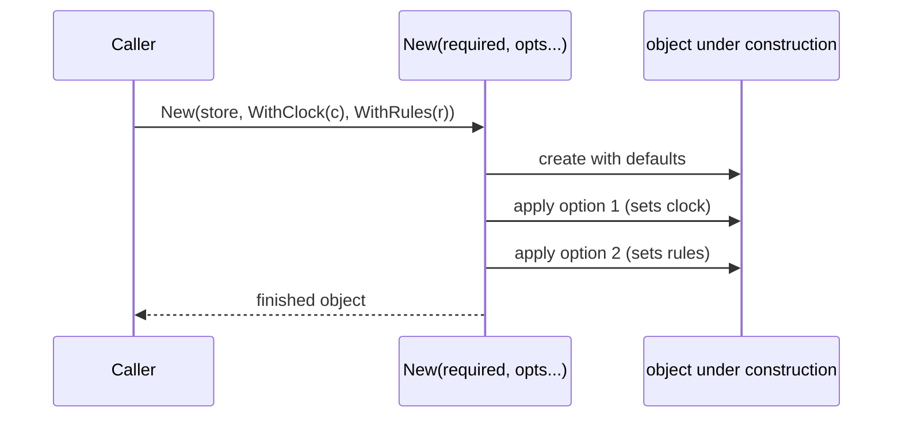

# Functional options

## The problem

`app.New` builds the document service. It needs a store, always. It can
also be given a clock, an ID generator, a logger, a rule set and resource
limits, each of which has a sensible default that production mostly keeps
and tests mostly replace, one or two at a time.

Go has no optional parameters, no default parameter values and no function
overloading. The plain ways to write this constructor are all unpleasant:

```go
// Every caller passes everything, including what it does not care about.
app.New(ctx, store, clock, ids, logger, ruleset, limits)

// Or: a family of constructors that grows with every combination.
app.NewWithClock(ctx, store, clock)
app.NewWithClockAndRules(ctx, store, clock, ruleset)
```

The first form breaks every call site whenever a setting is added. The
second explodes combinatorially.

## The pattern

Functional options were described by Rob Pike and popularised by Dave
Cheney around 2014. The idea: the constructor takes its required arguments
and then any number of *options*. An option is a function that modifies the
object being built. Each setting gets a small function that returns such an
option.



The call site names exactly the settings it changes and nothing else.

## In candledb

### The option type and the options

[`internal/app/service.go`](../../../internal/app/service.go):

```go
// Option configures a Service. This is the functional options pattern: New
// takes any number of options, each a function that adjusts the Service, so
// new settings can be added without changing New's signature or breaking
// existing callers.
type Option func(*Service)

// WithClock replaces the system clock.
func WithClock(c Clock) Option { return func(s *Service) { s.clock = c } }
```

An `Option` is a function that receives the service and adjusts it.
`WithClock(c)` does not set anything when it is called. It *returns a
function* that will set the clock when the constructor runs it. The
returned function is a closure: it remembers `c`.

There are five options, each one line: `WithClock`, `WithIDGenerator`,
`WithLogger`, `WithRules`, `WithLimits`.

### The constructor

```go
func New(ctx context.Context, store Store, opts ...Option) (*Service, error) {
	s := &Service{
		store:  store,
		clock:  SystemClock{},
		ids:    RandomIDs{},
		logger: slog.New(slog.NewTextHandler(io.Discard, nil)),
		limits: DefaultLimits,
		hub:    newHub(),
	}
	s.rules.Store(rules.DenyAll())
	for _, opt := range opts {
		opt(s)
```

Three steps, in this order:

1. Build the object with every default filled in. The service is usable at
   this point. (The excerpt stops inside the loop; two closing braces
   follow.)
2. Run the options, in the order given. Each overwrites one default.
3. (After the excerpt) do the work that depends on the final settings: read
   the store's version.

The required dependency, `store`, is an ordinary parameter. Options are for
what is optional. A constructor in which everything is an option hides what
is mandatory.

`opts ...Option` is a variadic parameter: the caller may pass zero or more.
`app.New(ctx, store)` is a complete call.

### The call sites

Production, in
[`cmd/candledb/serve.go`](../../../cmd/candledb/serve.go), sets two:

```go
docs, err := app.New(ctx, store, app.WithLogger(logger), app.WithRules(ruleset))
```

The unit tests set three by default and let each test add more. This helper
shows a second benefit: options are values, so they can be collected in a
slice, appended to and passed on:

```go
clock := newClock()
base := []app.Option{app.WithClock(clock), app.WithRules(ruleset), app.WithIDGenerator(&sequentialIDs{})}
svc, err := app.New(ctx, memory.NewStore(), append(base, opts...)...)
```

A test that needs a small queue to provoke back-pressure passes just that:

```go
func TestSlowListenerIsDisconnected(t *testing.T) {
	svc, _ := newService(t, "", app.WithLimits(app.Limits{
		MaxBatchWrites: 10, MaxQueryResults: 100, MaxSessions: 10, MaxTargetsPerSession: 10, SessionBuffer: 4,
	}))
```

Because later options override earlier ones, the test's `WithLimits`,
appended after the helper's defaults, wins.

### The same pattern in the HTTP adapter

[`internal/adapters/httpapi/server.go`](../../../internal/adapters/httpapi/server.go)
uses it again with its own `Option` type, and one of its options shows that
an option can do more than copy a value:

```go
// WithAuthRateLimit limits sign-up, sign-in and refresh attempts per client
// address: burst requests at once, refilled at perMinute.
func WithAuthRateLimit(perMinute float64, burst int) Option {
	return func(s *Server) { s.authLimiter = newRateLimiter(perMinute/60, burst, time.Now) }
}
```

The caller thinks in "requests per minute"; the option converts to the
limiter's "tokens per second" and constructs the limiter. The option
functions are also where each setting's documentation lives: the comment on
`WithTrustProxy` carries the security warning about forged headers, right
where a caller will read it.

At the composition root the settings read as a list:

```go
api := httpapi.New(docs, auth,
	httpapi.WithLogger(logger),
	httpapi.WithCORSOrigins(splitList(cfg.corsOrigins)),
	httpapi.WithTrustProxy(cfg.trustProxy),
	httpapi.WithStoreStats(store),
	httpapi.WithAuthRateLimit(cfg.authRate, cfg.authBurst),
)
```

### Where the code uses a plain struct instead

Not every configuration in this codebase is functional options, and the
difference is instructive.

```go
// Limits bound the resources one request or one client can consume.
type Limits struct {
	MaxBatchWrites       int // writes in one commit
	MaxQueryResults      int // documents returned by one query
	MaxSessions          int // concurrent listen sessions
	MaxTargetsPerSession int // listeners multiplexed on one session
	SessionBuffer        int // commits a slow session may fall behind
}
```

`Limits` is a struct of five integers, passed whole through one option,
`WithLimits`. And the account service takes its settings as a struct
parameter, with no options at all:

```go
// AuthConfig tunes the account service.
type AuthConfig struct {
	AccessTTL  time.Duration // lifetime of an access token
	RefreshTTL time.Duration // lifetime of a refresh token
	// DisableSignup turns off self-registration; existing users can still
	// sign in.
	DisableSignup bool
	// AdminKey, when not empty, is a secret that grants admin access (which
	// bypasses security rules) to a request presenting it as bearer token.
	AdminKey string
}
```

`NewAuthService(users, hasher, tokens, clock, cfg)` then fills in defaults
for the zero-valued fields.

Why the difference?

| | `app.Option` | `app.AuthConfig`, `app.Limits` |
|---|---|---|
| What is being set | collaborators: objects with behaviour (a clock, a logger, a rule set) | plain values: durations, flags, numbers |
| Is the zero value a usable "not set"? | No. A nil logger would crash | Yes. A zero duration means "use the default" |
| Typical source | wired in code | read from flags or a file, as a group |
| Printable, comparable, serialisable | no (functions) | yes |

A struct of values is simpler than functional options whenever "zero means
default" works, and it can be logged, compared in tests and loaded from
configuration. Functional options are better when settings are dependencies
to inject, when zero is a meaningful value that must be distinguishable
from "not set", or when an option needs to run code.

Both forms have one weakness in common here, shown by `WithLimits`: it
replaces the *whole* struct. A test that wants only `SessionBuffer: 4` must
spell out the other four fields too, because a zero `MaxBatchWrites` would
reject every commit. You can see that in the excerpt from
`TestSlowListenerIsDisconnected` above. Options per limit, or a
`DefaultLimits` copy with one field changed, would avoid it:

```go
limits := app.DefaultLimits
limits.SessionBuffer = 4
svc, _ := newService(t, "", app.WithLimits(limits))
```

The tests do not use this shorter form, which is a small inconsistency
worth knowing about, not a defect.

## What Go changes

Functional options are a Go idiom to begin with; they exist because of
what Go lacks (named and default arguments) and what it has (first-class
functions, closures, variadic parameters). The comparison is therefore with
the patterns other languages use for the same problem.

- **Versus the builder pattern.** A builder is an object with a method per
  setting and a final `Build()`:
  `NewServiceBuilder(store).Clock(c).Rules(r).Build()`. It needs a second
  type that mirrors the first, and an explicit build step that can be
  forgotten. Functional options need neither. A builder is still the better
  fit when construction has ordered stages, or when the partially
  configured thing is itself passed around; the JavaScript client's query
  builder (`where().orderBy().limit()`) is that case.
- **Versus a config struct.** Discussed above. Go's zero values make config
  structs unusually pleasant, which is why they remain the first choice for
  plain data.
- **Versus setters after construction.** `svc.SetClock(c)` after `New`
  would let the object exist in a half-configured state and would require
  locking if another goroutine already used it. Options run before the
  object escapes the constructor. (`Service.SetRules` does exist, because
  rules really do change at run time, and it uses an atomic pointer for
  exactly that reason.)

Two variations you will meet in other codebases:

- Options that return an `error`, applied as `if err := opt(s); err != nil`.
  Useful when an option can be invalid (a negative size). Here validation
  of flags happens earlier, in `parseServeFlags`.
- An `Option` *interface* with an unexported `apply` method instead of a
  function type. It lets options be compared and printed in tests, at the
  cost of a struct per option.

## Costs and when not to use it

- **More machinery than a struct.** One type, plus one function per
  setting. For three integer settings that is pure overhead.
- **Discoverability.** The settings are not fields you can see in one
  place; they are functions scattered through a file, found by typing
  `app.With` and reading the completions.
- **Defaults are invisible at the call site**, and the configuration of a
  built object cannot be printed, because functions are opaque.
- **Order dependence.** A later option silently overrides an earlier one.
  Usually that is the wanted behaviour, as in the test helper; occasionally
  it hides a mistake.
- **Required things must not be options.** If `store` were
  `WithStore(...)`, forgetting it would compile and fail at run time.

Do not use functional options for a type with one or two settings, for
settings that are all plain values with meaningful zero defaults, or inside
a package for its own private constructors. Use them at a package's public
boundary when the list of optional collaborators is likely to grow.

## Questions to check your understanding

1. What does `app.WithClock(c)` do at the moment it is called? When is the
   clock actually set?
2. `New` runs the options *before* reading the version from the store. Find
   an option for which the opposite order would be a bug, or explain why
   none exists today.
3. A caller writes
   `app.New(ctx, store, app.WithRules(a), app.WithRules(b))`. Which rule
   set is in force? Which line decides?
4. What rules are in force for `app.New(ctx, store)` with no options, and
   why is that the right default for this setting in particular?
5. `httpapi.WithHeartbeat(0)` compiles. What happens at run time, and what
   would happen without the check inside the option? What does that tell
   you about one of the listed costs?

<details>
<summary>Answers</summary>

1. It creates and returns a closure that captures `c`. Nothing is set yet.
   The clock is set when `New` reaches `opt(s)` for that option, inside the
   loop over `opts`.
2. None of the five options affects how the version is read, so today the
   order would not matter for them. It would matter for a hypothetical
   option that wrapped or replaced the store. The chosen order (defaults,
   then options, then work) is the safe convention because it never has to
   be revisited when such an option appears.
3. `b`. Options run in argument order, and each call to the function
   returned by `WithRules` stores its rule set over the previous one, in
   the loop `for _, opt := range opts { opt(s) }`.
4. `rules.DenyAll()`, set by `s.rules.Store(rules.DenyAll())` just before
   the options run. A security setting should fail closed: a service that
   someone forgot to configure refuses everything, instead of serving
   everything. `TestDefaultRulesDenyEverything` pins this.
5. Nothing: `WithHeartbeat` ignores a duration that is not positive, so the
   default of 20 seconds stays. Without that check, `handleListen` would
   call `time.NewTicker(0)`, which panics. By then the handler has already
   sent the 200 status and the `ready` message, so every listen stream
   would open, deliver `ready`, and then break. The check has to stay
   silent, which illustrates the cost: an option that cannot return an
   error has nowhere to report an invalid value.

</details>

## Try it

**Add an option for a single limit.**

Goal: `app.WithMaxQueryResults(n int)` lets a caller change that one limit
without restating the other four.

1. In `service.go`, add the option. It sets `s.limits.MaxQueryResults`.
   Decide what it does for `n <= 0`, and write that in its comment.
2. Think about order: what happens with
   `app.New(ctx, store, app.WithMaxQueryResults(5), app.WithLimits(l))`, and
   with the two swapped? Is that acceptable? Document it or prevent it.
3. Rewrite `TestQueryLimits` in `app/rules_test.go` to use the new option
   in place of the five-field `WithLimits`.
4. Add a `-max-query-results` flag in `cmd/candledb/serve.go` and pass it
   through.

How to verify: `go test ./internal/app ./cmd/...` passes, and a server
started with `-max-query-results 2` answers an unlimited query over three
documents with a 429 `resource_exhausted` error.

Then weigh it: you added a second way to set a value that `WithLimits`
already sets. Was it worth it? Would changing `Limits` so that zero fields
mean "use the default" have been the better fix?

---

This is the last pattern page. For an overview of all of them, and of the
patterns that were left out on purpose, go back to the
[patterns index](README.md). To see them working together on a single
request, re-read [the request walk-through](../02-request-walkthrough.md)
with the pattern names in mind: the request passes through *decorators*,
becomes a *command*, is judged by the *interpreter*, is stored through a
*port*, and is announced to *observers*.
