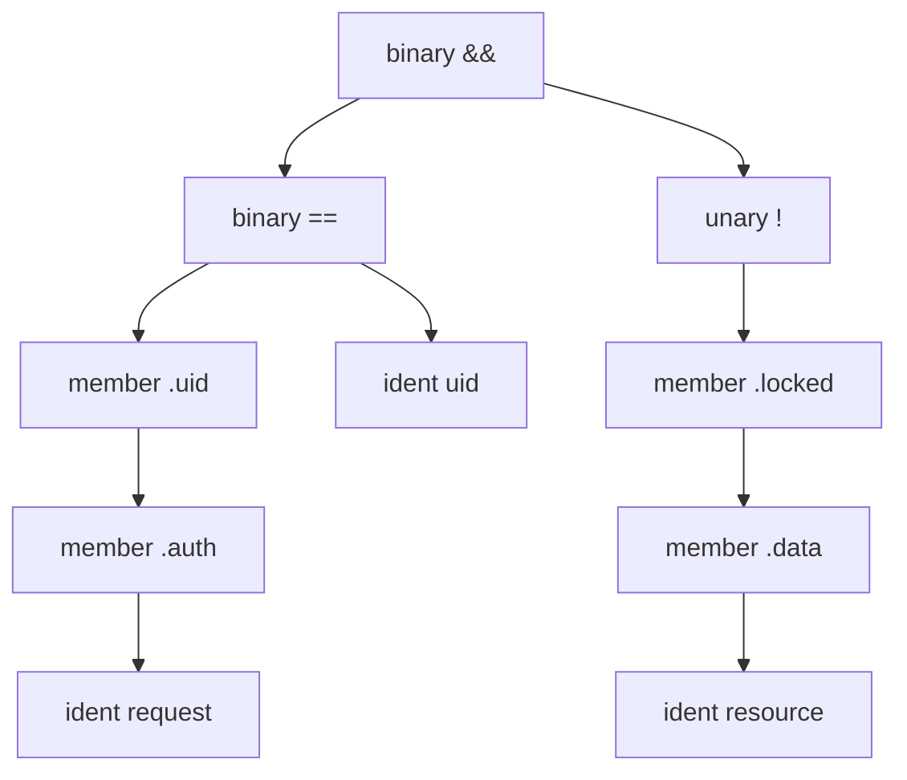
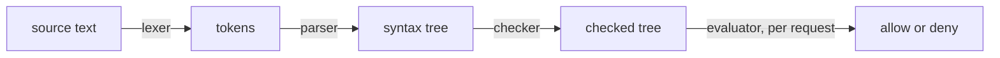

# Interpreter

## The problem

Who may read and write what is different for every application built on
candledb. One app has private todo lists; another has chat rooms with
members; a third has public posts with private drafts. The server cannot
know these policies in advance, and its operators should not need to edit
Go code and rebuild the server to state them.

The options were:

- **Configuration flags** such as "documents are private to their owner".
  Fine for two or three policies, hopeless for the general case.
- **Plugins or callbacks in Go.** Powerful, but now running the server
  means compiling it, and a mistake can crash it.
- **A small language**, made for exactly this job, that the server reads
  from a file and evaluates for every request.

The third is what Firestore does, and it is what this project does:

```text
match /rooms/{room}/messages/{msg} {
  allow read: if request.auth.uid in get("rooms/" + room).data.members;
}
```

## The pattern

The interpreter pattern says: represent each construct of a language as a
node type, represent a sentence in the language as a tree of such nodes,
and evaluate the tree by having each node evaluate its children and combine
the results.

For `request.auth.uid == uid && !resource.data.locked` the tree is:



Two more names from the pattern books apply to this tree. It is a
**composite**: a node holds other nodes of the same general kind, so a tree
of any depth is handled by code written for one node. And the tree as a
whole is called an **abstract syntax tree** (AST): "abstract" because it
keeps the structure and drops the punctuation.

Getting from text to a tree takes two steps that precede the pattern
proper: a **lexer** cuts the text into tokens (`request`, `.`, `auth`,
`==`, ...), and a **parser** arranges tokens into the tree. Together:



The first three steps happen once, when the rules are loaded. Only the last
runs per request. How each step is written in Go is the subject of
[Go chapter 8](../../go/08-interpreter.md); this page is about the design.

## In candledb

The package is [`internal/rules`](../../../internal/rules), six files:

| File | Stage |
|---|---|
| [`lexer.go`](../../../internal/rules/lexer.go) | text to tokens |
| [`ast.go`](../../../internal/rules/ast.go) | the node types |
| [`parser.go`](../../../internal/rules/parser.go) | tokens to tree |
| [`check.go`](../../../internal/rules/check.go) | every name in the tree is defined |
| [`eval.go`](../../../internal/rules/eval.go) | tree plus request to decision |
| [`builtins.go`](../../../internal/rules/builtins.go) | `size`, `matches`, `get`, type names |

### The node types

```go
// expr is a node of an expression's syntax tree. Like domain.Value it is a
// closed set of types that the evaluator walks with a type switch.
type expr interface{ position() Pos }

type (
	// literalExpr is a constant: 1, "text", true, null.
	literalExpr struct {
		pos   Pos
		value domain.Value
	}
	// identExpr names a variable: request, resource, a wildcard, a parameter.
	identExpr struct {
		pos  Pos
		name string
```

There are nine node types in all: literal, identifier, member access, index,
call, unary, binary, list and `is`. Look at what a node contains: its
position in the source (for error messages) and its children as `expr`
values. `binaryExpr` has `l, r expr`. That one recursive field is the
composite pattern.

Above expressions sits a second, simpler tree for the file's structure: a
`Ruleset` holds `match` blocks, a `match` holds `allow` statements, child
`match` blocks and functions.

### The evaluator

```go
// eval computes the value of an expression. It is the heart of the
// interpreter: a type switch with one case per kind of syntax node, each
// evaluating its children by calling eval again.
func (ev *evaluator) eval(e expr, sc *scope) (domain.Value, error) {
	switch e := e.(type) {
	case *literalExpr:
		return e.value, nil
```

`eval` is one function with one `case` per node type. Each case evaluates
the node's children by calling `eval` again and combines the results. The
case for member access shows the whole shape:

```go
case *memberExpr:
	x, err := ev.eval(e.x, sc)
	if err != nil {
		return nil, err
	}
	m, ok := x.(domain.Map)
	if !ok {
		return nil, evalErr(e.pos, "cannot read field %s of a %s", e.name, x.Kind())
	}
	v, ok := m[e.name]
	if !ok {
		return nil, evalErr(e.pos, "field %s does not exist", e.name)
	}
	return v, nil
```

Evaluate the child (`e.x`); if that failed, pass the error up; check that
the result is a map; look up the field; return it. Every other case is a
variation on these five lines.

Three design choices in the evaluator are worth noticing.

**It computes with the domain's values.** The result type of `eval` is
`domain.Value`, the same type documents are made of. `resource.data` is not
converted into some rules-engine representation; it *is* the document's
map. `==` in a rule is `domain.Equal`, and `<` is `domain.Compare`, so a
comparison in a rule and the same comparison in a query filter can never
disagree.

**Errors mean "no".** A rule that reads a field of a missing document, or
compares a number with a string, does not crash the request or produce a
500. `eval` returns an error, and `holds` turns any error into a denial:

```go
// holds evaluates a condition to a yes or no. Errors and non-boolean
// results are a no.
func (ev *evaluator) holds(cond expr, sc *scope) bool {
	if cond == nil {
		return true
	}
	v, err := ev.eval(cond, sc)
	if err != nil {
		return false
	}
	b, ok := v.(domain.Bool)
	return ok && bool(b)
}
```

This is the safe direction for a security language: every failure closes
access, none opens it.

**The outside world comes in through one function.** The evaluator performs
no I/O. `get("users/ann")` in a rule calls `ev.get`, a `rules.Getter` that
the caller supplied. In production it is `Service.load`; in the rules
package's own tests it is a map lookup. The evaluator counts these calls
and stops at ten per request, and it limits function call depth to sixteen,
so no rules file can make one request arbitrarily expensive.

### The check before evaluation

A language evaluated at request time has a nasty failure mode: a typo
(`reqeust.auth`) is only discovered when a request reaches that branch, and
then, because errors mean "no", it looks like a correct denial.
[`check.go`](../../../internal/rules/check.go) closes that hole by walking
the tree once at load time and verifying that every identifier, function
and method name is defined in its scope:

```go
case *identExpr:
	if !vars[e.name] {
		return &SyntaxError{e.pos, "unknown name " + e.name}
	}
case *memberExpr:
	return c.expr(e.x, vars, funcs)
```

It is the same recursive walk as `eval`, with names in place of values. A
rules file with an unknown name is rejected by `candledb check-rules`, at
start-up and at reload, with a line and column.

### Where the interpreter meets the application

One call, in [`app/service.go`](../../../internal/app/service.go):

```go
return s.rules.Load().Allow(ctx, req, s.load)
```

`s.rules` is an atomic pointer to the parsed `Ruleset`. A reload parses the
new file completely and then swaps the pointer; a request in progress
finishes with the tree it started with. Since a `Ruleset` is never modified
after parsing, any number of requests evaluate the same tree at once
without locks.

## What Go changes: the type switch replaces the visitor

In the classic object-oriented version, each node class has its own
`evaluate()` method. That puts the evaluation logic in nine places, and
adding a second operation over the tree (here: the checker) means adding a
method to all nine classes. The standard remedy is the **visitor** pattern:
each node gets one generic `accept(visitor)` method, and each operation
becomes a visitor object with one method per node type. It works, at the
price of a double indirection that confuses most people the first time they
read it.

Go's type switch makes all of that unnecessary. An operation over the tree
is one function:

```go
switch e := e.(type) {
case *literalExpr: ...
case *identExpr:   ...
case *memberExpr:  ...
}
```

`eval` is such a function, and so is `checker.expr`. The node types carry
no behaviour at all beyond `position()`. Adding a third operation, say a
pretty-printer, means writing one new function and touching no existing
code. That is exactly what the visitor pattern promises, without the
pattern.

The trade-off is the mirror image. Adding a tenth *node type* means finding
every type switch and adding a case, and the Go compiler does not warn
about a missing case. Two things keep that manageable here: `eval` ends by
returning an error for a node it does not recognise, instead of silently
doing nothing, and the node
set is closed (the types are unexported, and `expr` is an interface whose
method is unexported), so every switch that exists is in this package. The
same reasoning applies to `domain.Value` and its `sealed()` method.

Which way to lean is a general design question, sometimes called the
expression problem: will you more often add operations, or add types? For a
syntax tree the answer is nearly always operations.

Other things Go contributes:

- **Parsing by precedence table.** The parser handles all binary operators
  with one loop and the `precedence` map, instead of one grammar function
  per precedence level.
- **Errors as values** make "errors mean no" a three-line function instead
  of a try/catch around the evaluator.
- **Fuzzing is built in.** `FuzzParse` feeds the parser random input; see
  [testing strategy](../04-testing-strategy.md).

## Costs and when not to use it

A language is the most expensive pattern on this list. Be honest about what
it costs:

- **You now maintain a language.** It needs a grammar, error messages with
  positions, documentation
  ([tour chapter 7](../../tour/07-security-rules.md)), a checker, tests for
  every operator and edge case, and eventually editor support. The rules
  package is about 1,700 lines, the largest piece of the core.
- **Users must learn it.** Every construct that differs from what they
  expect is a support question, and here a security bug.
- **Tree-walking is slow** compared with compiled code. A rule evaluation
  here costs a few map lookups and allocations, which is small next to a
  database read. For a hot inner loop it would not be.
- **It is hard to keep small.** Users will ask for loops, variables, string
  formatting. Each is reasonable alone. The discipline is to keep asking
  whether the language is still for *rules*.

Do not write an interpreter when a configuration file of data would do (a
list of allowed origins is not a language), or when the "users" are your own
team and could simply write Go. Do consider one when people outside the
codebase must express logic, the logic must be safe to run, and it must
change without a rebuild. Security rules meet all three.

## Questions to check your understanding

1. In the rule `resource.data.owner == request.auth.uid`, what happens when
   the caller is not signed in? Trace it through `eval` and `holds`.
2. `a || b` is true when `a` fails with an error and `b` is true. Find the
   function that implements this and explain why
   `resource == null || resource.data.owner == request.auth.uid` therefore
   works in either order.
3. Why can two requests evaluate the same `*Ruleset` at the same time
   without a mutex, even though `evaluator` has fields that change
   (`lookups`, `depth`)?
4. A function defined inside `match /orgs/{org} { ... }` uses the variable
   `org`. Which code guarantees, before any request arrives, that `org`
   will exist when the function runs?
5. Suppose you add a new node type `condExpr` for `a ? b : c` and forget to
   handle it in `checker.expr`. What goes wrong, and when would you find
   out?

<details>
<summary>Answers</summary>

1. `request.auth` evaluates to `domain.Null{}` (see `requestValue`). The
   `memberExpr` case for `.uid` evaluates its child, gets `Null`, finds it
   is not a `domain.Map`, and returns an error "cannot read field uid of a
   null". The `binaryExpr` case returns that error from evaluating its right
   operand. `holds` receives the error and returns false: denied.
2. `evaluator.logical`. It evaluates the left side; if that is the decisive
   value (`true` for `||`), it returns. Otherwise it evaluates the right
   side, and if *that* is decisive it returns it, even when the left side
   was an error. Only if neither side decides does a stored error propagate.
   So when `resource` is null, `resource.data.owner` fails, but
   `resource == null` is true and decides the `||`, whichever side it is on.
3. `Ruleset.Allow` creates a new `evaluator` value for every call. The
   changing fields belong to that per-request value. The tree itself
   (`matches`, `funcs`, all the node structs) is only read.
4. `check` in `check.go`. `checker.match` adds the wildcard names of the
   block's pattern to the set of known names and checks the block's
   functions with that set (`c.function(fn, vars, funcs)`). A function body
   that uses a name not in the set fails with "unknown name" at parse time.
   Since a function is only callable from inside the block that defines it
   (function tables are scoped the same way), the wildcard is always bound
   when it runs.
5. `checker.expr` has no `default` case and ends with `return nil`, so the
   new node would be accepted without its children being checked. A typo
   inside a conditional expression would pass `check-rules` and only show
   up at request time as an unexplained denial. You would find out from a
   confused user. A test in `TestParseErrors` with an unknown name inside
   the new construct would catch it; so would giving the switch a `default`
   that reports an unhandled node type.

</details>

## Try it

**Add a ternary expression: `cond ? a : b`.**

Goal: `allow read: if (resource.data.public ? true : request.auth != null);`
parses and evaluates.

1. `lexer.go`: add `"?"` to the punctuation list (`":"` is already there).
2. `ast.go`: add a `condExpr` node with three children and a `position`
   method.
3. `parser.go`: parse it in `expr`, after `p.binary(1)`: if the next token
   is `?`, parse two more expressions separated by `:`.
4. `check.go` and `eval.go`: add the case. In `eval`, evaluate the
   condition with `evalBool`, then evaluate *only* the chosen branch.
5. `rules_test.go`: add rows to `TestExpressions`, including one where the
   branch not taken would fail (`true ? 1 == 1 : resource.data.missing`),
   and a row to `TestParseErrors` for an unknown name inside a branch.

How to verify: `go test ./internal/rules` passes, and so does a short fuzz
run (`make fuzz`). Then count the places you had to touch for one new node
type, and compare with what adding a pretty-printing *operation* would
take. That difference is the expression problem.

Next: [Decorator](decorator.md)
