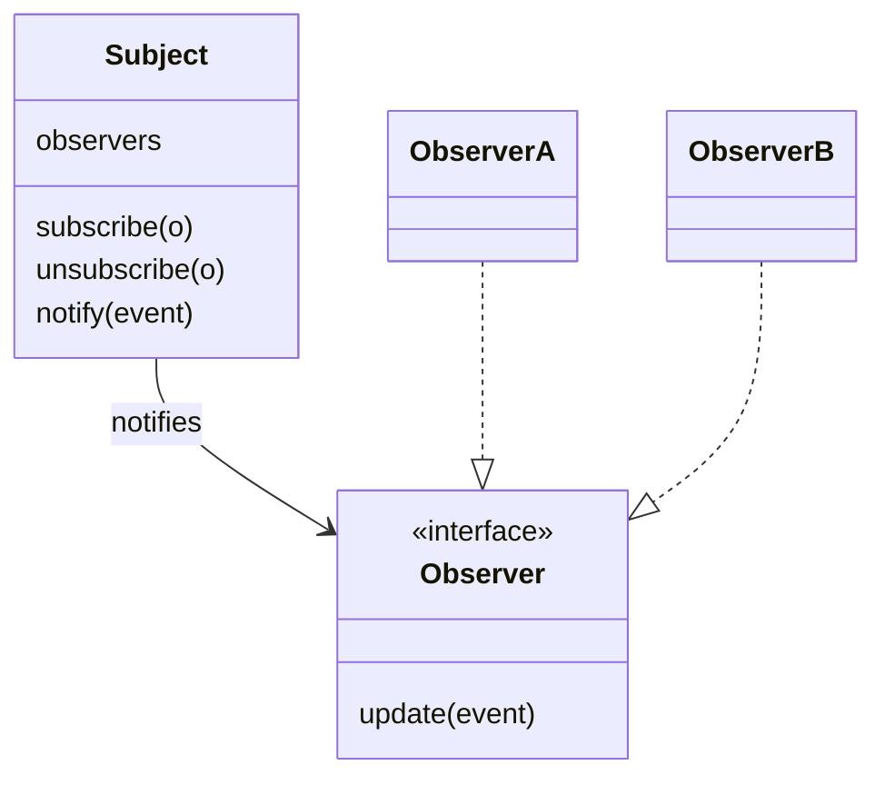
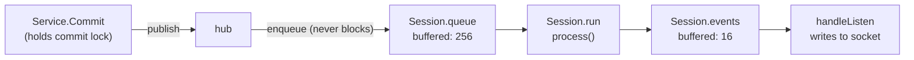

# Observer

## The problem

When a commit succeeds, clients that are listening must be told. At the
point where the commit happens, in `Service.Commit`, the code knows which
documents changed. It does not know who is listening, to what, over which
connection, or how fast they read.

The direct approach would be for `Commit` to loop over open HTTP
connections and write to each. That fails in several ways at once:

- `Commit` would need to know about HTTP, which the
  [dependency rule](../01-hexagonal.md) forbids.
- A client on a slow network would make `Commit` slow for everyone, since
  the commit holds the write lock.
- Each listener needs its own work done (does this document match *my*
  query, may *I* read it), which does not belong in the write path.

## The pattern

The observer pattern separates the thing that changes (the **subject**)
from the things that react (the **observers**). The subject keeps a list of
observers and offers three operations: subscribe, unsubscribe, notify. It
knows nothing about what an observer does when notified.



In the classic form, `notify` calls `update` on each observer, one after
the other, on the subject's own thread. Two weaknesses of that form matter
here: a slow observer delays the subject, and an observer that calls back
into the subject from inside `update` can deadlock or corrupt it.

## In candledb

Everything is in [`internal/app/listen.go`](../../../internal/app/listen.go).
The file's opening comment states the roles:

```go
// This file implements realtime listeners with the observer pattern: the
// commit path is the subject, sessions are the observers, and the hub is
// the registry that connects them.
//
//	Commit --publish--> hub --enqueue--> Session.queue --run--> Session.Events()
//
// The commit path must never wait for a slow client, so publishing only
// drops a pointer into each interested session's buffered queue. Each
// session has its own goroutine that turns queued commits into events at
// whatever pace its client can read them.
```

| Role | Type | Operation |
|---|---|---|
| Subject | the commit path, through `hub` | `hub.publish` is "notify" |
| Registry of observers | `hub` | `hub.interest(+1)` is "subscribe", `hub.interest(-1)` is "unsubscribe" |
| Observer | `Session` | `Session.enqueue` is "update" |
| Event | `commitBatch` | the version and the before/after of each document |

### The registry

```go
// hub is the registry of who listens to what. It answers one question for
// the commit path: which sessions care about this document?
type hub struct {
	mu           sync.Mutex
	sessions     map[string]*Session
	byDoc        map[domain.DocPath]map[*Session]int
	byCollection map[domain.CollectionPath]map[*Session]int
	targets      int
	// closed is set when the service shuts down; no session may open after.
	closed bool
}
```

A plain observer list would be one slice of all sessions, and every commit
would visit every session. The hub is indexed instead: by document path and
by collection path. `publish` looks up only the sessions that registered
interest in a document that the commit touched. With a thousand listeners
on a thousand different collections, a commit visits one of them.

The values are counts, not booleans, because one session can hold several
targets on the same collection. Removing one target must not unsubscribe
the others.

### Notify

```go
// publish hands a commit to every session with a target that could be
// affected. It is called with the commit lock held, so batches reach each
// session in commit order.
func (h *hub) publish(b *commitBatch) {
	h.mu.Lock()
	interested := map[*Session]struct{}{}
	for _, c := range b.changes {
		for s := range h.byDoc[c.path] {
			interested[s] = struct{}{}
		}
		for s := range h.byCollection[c.path.Parent()] {
			interested[s] = struct{}{}
		}
	}
	h.mu.Unlock()

	for s := range interested {
		s.enqueue(queueItem{batch: b})
	}
}
```

Two things differ from the textbook `notify`:

1. The set of interested sessions is collected while holding the hub's
   mutex, and the mutex is released *before* any session is touched. An
   observer's reaction (which may close the session, which needs the hub's
   mutex to unregister) therefore cannot deadlock with the notification.
2. `enqueue` does not do the observer's work. It drops a pointer into the
   session's queue and returns.

### Update, without blocking

```go
func (s *Session) enqueue(item queueItem) {
	select {
	case s.queue <- item:
	default:
		s.svc.logger.Warn("closing listen session that fell behind", "session", s.id)
		s.Close()
	}
}
```

A `select` with a `default` case tries to send and gives up immediately if
the channel is full. So `publish` takes the same short time whether the
client is fast, slow or gone. The price is a policy decision, visible right
here: a session that cannot keep up is closed.

### The observer's own goroutine

```go
for {
	select {
	case <-s.done:
		return
	case item := <-s.queue:
		var out []Event
		if item.event != nil {
			out = []Event{*item.event}
```

Each session has one goroutine running `Session.run`. It takes items off
the queue in order and, for a commit, calls `process` to work out what the
commit means for each of this session's targets: match the query, check the
rules for this session's principal, build the events. All the per-listener
work happens here, on the listener's time, after the commit lock has been
released.

The result goes out on a second channel, `events`, which the HTTP adapter
reads. So there are two queues between a commit and a socket:



If the client stops reading, the socket write blocks, `events` fills, `run`
blocks on sending, `queue` fills, and the next `enqueue` closes the session.
This chain is called back-pressure: slowness at the end propagates backwards
until it reaches a point with a policy. Here the policy is "disconnect", and
it sits at the one place that must never wait.

### Subscribe, consistently

Subscribing has a subtlety the classic pattern ignores. A new listener
needs the current state *and* all later changes, with no gap and no
overlap. `Session.AddTarget` gets this by holding the commit lock in shared
mode while it takes the snapshot and registers:

```go
// Holding the commit lock (shared) freezes the database version while
// the snapshot is taken and the target is registered. Every commit is
// then either fully inside the snapshot or delivered afterwards as a
// change; none is missed and none is seen twice.
svc := s.svc
svc.commitMu.RLock()
defer svc.commitMu.RUnlock()
s.mu.Lock()
defer s.mu.Unlock()
```

While that lock is held no commit can run. The snapshot is therefore the
state at one exact version, and the registration is in place before the
next commit publishes. `TestSnapshotAndChangesAreConsistent` in
[`listen_test.go`](../../../internal/app/listen_test.go) starts listeners
while four writers are busy and checks that snapshot plus changes equal the
final state for every one of them.

## What Go changes

- **The observer interface disappears.** The classic pattern needs an
  `Observer` interface so the subject can call different kinds of observer.
  Here there is one kind, `*Session`, and the "call" is a channel send.
  The channel is the interface: anything that can receive from it can
  observe.
- **Channels decouple time, not only types.** A method call makes the
  subject wait for the observer. A buffered channel lets them run at
  different speeds, up to the buffer's size, and `select` with `default`
  makes the full-buffer case an explicit branch.
- **Each observer gets a goroutine.** A goroutine costs a few kilobytes, so
  one per session is cheap. In return, all of a session's processing is
  sequential and needs no locking against itself; only `targets` is guarded
  by a mutex, because `AddTarget` runs on another goroutine.
- **Unsubscribing is where leaks hide.** A forgotten observer in a
  garbage-collected language is a memory leak; in Go it is also a goroutine
  leak. `Session.Close` is the single exit: it closes `done` (which ends
  `run`), removes every target from the hub and removes the session. It is
  wrapped in `sync.Once` so that the client disconnecting, the server
  shutting down and the queue overflowing can all call it safely.
  `TestListenCleansUpWhenClientDisconnects` in the integration tests checks
  that the counts return to zero.

These primitives are explained in [Go chapter 9](../../go/09-concurrency.md).

## Costs and when not to use it

- **Indirection in control flow.** Reading `Commit` does not tell you what
  happens as a result of a commit. You have to know that `publish` leads to
  `run` on other goroutines. Tools like "find callers" stop at the channel.
- **Ordering becomes a design question.** Events reach one session in
  commit order because `publish` runs under the commit lock and each session
  has one queue. Two sessions may see the same commit at different times.
  That is fine here; where observers must agree, it is not.
- **Failure handling is separate.** If `process` fails, the commit has
  already succeeded. The session is closed and the client resynchronises.
  An observer cannot veto the change it observes.
- **Lifetime management.** Every subscribe needs a matching unsubscribe on
  every exit path.

Do not use an observer when there is one known reaction to an event. A
direct function call is clearer: `Commit` calls `s.store.Apply` directly,
not through a notification. Use it when the set of reactors is open and
changes at run time, as the set of connected clients does.

## Questions to check your understanding

1. `hub.publish` is called while `Service.Commit` holds `commitMu`. Why is
   that safe, given that sessions may take a long time to process a commit?
2. What happens, step by step, when a session's queue is full at the moment
   of `enqueue`?
3. `hub.byCollection` maps to `map[*Session]int`. Construct a sequence of
   `AddTarget` and `RemoveTarget` calls where a `map[*Session]bool` would
   give a wrong result.
4. `AddTarget` puts the first snapshot on `s.queue` instead of sending it
   directly on `s.events`. What could go wrong if it used `s.events`?
5. Which goroutine closes `s.events`, and why that one?

<details>
<summary>Answers</summary>

1. `publish` does no processing. It looks up sessions and does a
   non-blocking send to each. The processing happens later in each session's
   own goroutine, without the commit lock.
2. The `select` in `enqueue` takes the `default` branch, logs a warning and
   calls `Session.Close`. `Close` closes `done`, removes the session's
   targets from the hub's tables and deletes the session from
   `hub.sessions`. `run` sees `done` closed and returns; its deferred
   `close(s.events)` runs. The HTTP handler's receive from `Events()`
   reports the channel closed, so it writes a `session_closed` error event
   and returns, which ends the HTTP response. The client reconnects.
3. A session adds target 1 and target 2, both queries on collection
   `tasks`. It removes target 1. With booleans, the entry for the session
   under `tasks` would be deleted, and target 2 would silently stop
   receiving events. With counts the entry goes from 2 to 1 and stays.
4. Two problems. Sending on `events` can block (the buffer is small) while
   `AddTarget` holds the commit lock in shared mode, which would stall every
   commit behind a slow client. And `events` is written by `run`; a second
   writer could interleave the snapshot with events that `run` is sending,
   so a later change might arrive before the snapshot. One writer per
   channel keeps the order.
5. The session's own goroutine, in `run`, with `defer close(s.events)`. It
   is the only sender on that channel. Closing a channel from the receiving
   side, or from a second goroutine, risks a send on a closed channel, which
   panics.

</details>

## Try it

**Add a second kind of observer: an audit log.**

Goal: every commit is appended to a log (a slice in memory is enough) with
its version and the paths it changed, without `Commit` knowing about the
log.

1. In `app`, define a small interface with one method that receives a
   commit's version and changed paths. Give `Service` a slice of these and
   an option `WithCommitObserver(...)` to add one.
2. Call them from the place `hub.publish` is called. Decide, and write down
   in a comment, whether an observer may block the commit and what happens
   if it panics.
3. Write a test in `app_test` with an observer that records what it
   receives. Commit a batch touching two documents and assert on the record.

How to verify: the new test passes under `go test -race ./internal/app`, and
the existing listener tests are unchanged. Then compare your interface with
how `hub` works: you now have the classic synchronous form next to the
channel form. Which would you choose for writing the log to disk, and why?

Next: [Strategy](strategy.md)
