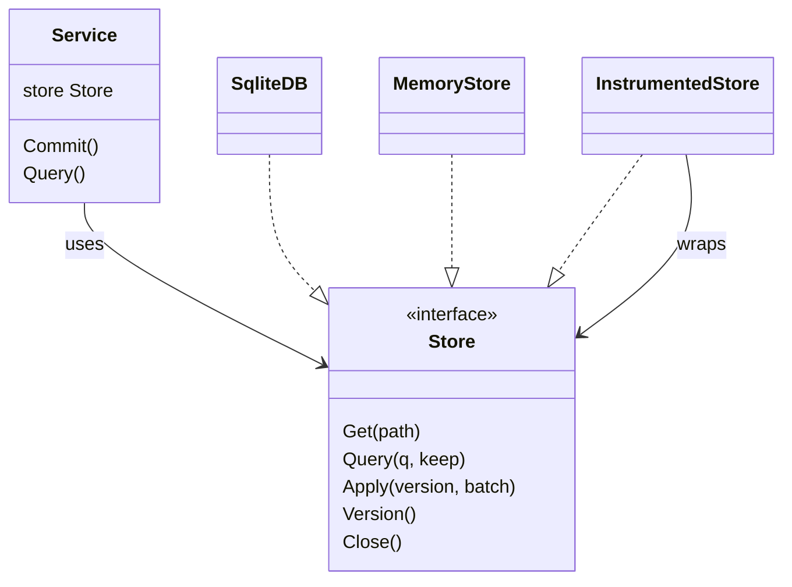

# Ports and adapters, and the repository

This is the pattern the whole program is shaped by. The
[hexagonal architecture](../01-hexagonal.md) page describes it at the level
of packages. This page looks at it at the level of one interface and its
implementations, and at its close relative, the repository.

## The problem

`Service.Commit` has to load documents and store documents. `Service.Query`
has to find documents. Somewhere, that means SQL. The question is whether
the use cases should contain it.

If they do:

- The use case tests need a database file.
- The logic that matters (preconditions, rules, ordering of steps) is
  interleaved with `tx.ExecContext` calls and their error handling.
- An in-memory store for fast tests is impossible without a second copy of
  every use case.

## The pattern

Two ideas, usually found together.

A **repository** is an object that looks, to its caller, like a collection
of domain objects: "give me the document at this path", "store these
documents". It hides how and where they are kept. The term comes from
Eric Evans's *Domain-Driven Design*.

A **port** is the same idea seen from the architecture: an interface owned
by the application that states what it needs. An **adapter** implements a
port for one technology.



(`SqliteDB` stands for `sqlite.DB`, `MemoryStore` for `memory.Store` and
`InstrumentedStore` for `instrumented.Store`.)

The arrow that matters is the one from `Service` to `Store`: the use case
depends on an abstraction it owns. The dashed arrows point *towards* that
abstraction from the adapters. Nothing points from the application to
SQLite.

## In candledb

### The port

[`internal/app/ports.go`](../../../internal/app/ports.go):

```go
type Store interface {
	// Get returns the document at path, or an error wrapping
	// domain.ErrNotFound.
	Get(ctx context.Context, path domain.DocPath) (domain.Document, error)

	// Query returns the documents selected by q, in query order. keep, when
	// not nil, is an extra filter that is applied before the limit, so a
	// limited query still returns as many documents as it can.
	Query(ctx context.Context, q domain.Query, keep func(domain.Document) bool) ([]domain.Document, error)

	// Apply atomically stores a batch of mutations and records version as
	// the new version of the database. Either all of it happens or none.
	Apply(ctx context.Context, version int64, batch []Mutation) error

	// Version returns the version recorded by the last Apply, or 0.
	Version(ctx context.Context) (int64, error)

	Close() error
```

Five methods. Three things about how it is written:

- **It speaks the domain's language.** Parameters and results are
  `domain.DocPath`, `domain.Document`, `domain.Query`. There is no `sql.Tx`,
  no table name, no "row".
- **Its comments are a contract.** "Either all of it happens or none."
  "keep ... is applied before the limit." The interface cannot enforce
  these; the [contract tests](../04-testing-strategy.md) do.
- **It is shaped by its one consumer.** There is no `Delete` method, because
  a delete is a `Mutation` with a nil document inside `Apply`. There is no
  `List collections`, because no use case needs it. A port is not a general
  database API; it is exactly what the application calls.

The same file declares `UserStore` the same way, with one method worth
noticing:

```go
// TakeRefreshToken removes the token with the given hash and returns
// it, as one atomic step, so a refresh token can be used only once.
TakeRefreshToken(ctx context.Context, hash string) (RefreshToken, error)
```

"Remove and return, atomically" is a requirement of the *use case*
(a refresh token must work once). Stating it in the port, instead of
offering `Get` and `Delete` separately, pushes the atomicity down to where
it can be done properly.

### The simplest adapter

[`internal/adapters/memory/store.go`](../../../internal/adapters/memory/store.go)
is the shortest complete answer to "what must a store do":

```go
func (s *Store) Apply(_ context.Context, version int64, batch []app.Mutation) error {
	s.mu.Lock()
	defer s.mu.Unlock()
	for _, m := range batch {
		parent, id := m.Path.Parent(), m.Path.ID()
		if m.Doc == nil {
			delete(s.collections[parent], id)
			if len(s.collections[parent]) == 0 {
				delete(s.collections, parent)
			}
			continue
		}
		if s.collections[parent] == nil {
			s.collections[parent] = map[string]domain.Document{}
		}
		s.collections[parent][id] = *m.Doc
	}
	s.version = version
	return nil
}
```

A map of collections, each a map of documents, behind a mutex. Its `Query`
copies the candidates out and hands them to `domain.Query.Apply`.

### The real adapter

[`internal/adapters/sqlite/store.go`](../../../internal/adapters/sqlite/store.go)
implements the same five methods with a transaction, two tables and an index
encoding. Its `Get`:

```go
func (db *DB) Get(ctx context.Context, path domain.DocPath) (domain.Document, error) {
	parent := path.Parent()
	row := db.read.QueryRowContext(ctx,
		"SELECT "+docColumns+" FROM docs WHERE parent = ? AND id = ?", string(parent), path.ID())
	doc, err := scanDoc(row, parent)
	if errors.Is(err, sql.ErrNoRows) {
		return doc, fmt.Errorf("%w: document %s", domain.ErrNotFound, path)
	}
	return doc, err
}
```

Notice what the function does besides running the statement. The adapter
translates in both directions: a domain path becomes two SQL parameters, a row becomes a
`domain.Document`, and the database library's `sql.ErrNoRows` becomes the
domain's `ErrNotFound`. After this function, nothing above it can tell that
a SQL database was involved. That translation of *errors* is easy to forget
and essential: if `sql.ErrNoRows` leaked upwards, the application would have
to import `database/sql` to recognise it.

### The use

In [`internal/app/service.go`](../../../internal/app/service.go) the service
holds the port, not an adapter:

```go
type Service struct {
	store  Store
	clock  Clock
	ids    IDGenerator
	logger *slog.Logger
	limits Limits
```

and every access goes through it, for example `s.store.Get(ctx, path)` in
`load`. Which adapter is behind `store` is decided in
[`cmd/candledb/serve.go`](../../../cmd/candledb/serve.go) for production and
in each test's set-up for tests.

### The contract

One line per adapter runs the shared test suite:

```go
func TestStoreContract(t *testing.T) {
	storetest.Run(t, func(*testing.T) app.Store { return memory.NewStore() })
}
```

See [testing strategy](../04-testing-strategy.md), layer 3.

## What Go changes

- **No `implements`.** `sqlite.DB` never mentions `app.Store` in its type
  declaration. It has the methods, so it satisfies the interface. The
  package adds `var _ app.Store = (*DB)(nil)` only so that a mistake is
  reported in the adapter's own package.
- **The interface lives with the consumer.** In Java the repository
  interface is often placed in the domain package and implemented in an
  infrastructure package. In Go the usual home is the package that calls
  it, here `app`.
- **Small interfaces compose.** Nothing forces "storage" to be one
  interface. `Clock` and `IDGenerator` are ports with one method each, and
  `rules.Getter` is a port that is just a function type.
- **Embedding makes partial fakes cheap.** The instrumented store's test
  defines a failing store in four lines by embedding the interface and
  overriding two methods:

```go
// failing is a store whose Apply and Query always fail. Embedding the
// app.Store interface gives it every method; only the ones under test are
// overridden.
type failing struct{ app.Store }

func (failing) Apply(context.Context, int64, []app.Mutation) error { return errors.New("disk full") }
func (failing) Query(context.Context, domain.Query, func(domain.Document) bool) ([]domain.Document, error) {
	return nil, errors.New("disk gone")
```

## Costs and when not to use it

- **Indirection.** "Go to definition" on `s.store.Get` lands on an interface
  method, not on code. You have to know which adapter is in play.
- **Lowest common denominator.** The port can only offer what every adapter
  can do. SQLite could join documents to their index entries in clever ways;
  the port's `Query` does not let the application ask for that.
- **Leaky anyway.** Some properties pass through any interface: latency,
  consistency between calls, what "atomic" means under a power cut. The
  single-writer design in `app` quietly assumes a store owned by one
  process ([design decisions](../03-design-decisions.md)).
- **An interface with one implementation and no test fake is ceremony.** If
  candledb had only SQLite and tested everything against SQLite, the
  `Store` interface would be an extra name for `*sqlite.DB`. It earns its
  place here because there are three implementations and the use-case tests
  depend on the fast one.

Do not put a port in front of something that is pure computation. The rules
engine is used directly by `app` for that reason.

## Questions to check your understanding

1. `app.Store` has no method to delete a document. How does
   `DELETE /v1/documents/users/ada` remove one?
2. The memory store's `Query` copies the documents out of the map and
   releases its lock *before* calling `q.Apply`. Why not hold the read lock
   during filtering?
3. Which package would you have to change so that `Get` on a missing
   document returned `(domain.Document{}, nil)` and a boolean instead of an
   error? Name every implementation and every caller.
4. Why does `sqlite.UserStore.TakeRefreshToken` use a single
   `DELETE ... RETURNING` statement instead of a `SELECT` followed by a
   `DELETE`?
5. `instrumented.Store` implements `app.Store` and also holds an
   `app.Store`. Is it an adapter?

<details>
<summary>Answers</summary>

1. The handler builds a `domain.Write` with `OpDelete`. `Service.Commit`
   stages it as a nil document and passes `Mutation{Path: path, Doc: nil}`
   to `Store.Apply`, whose contract says a nil `Doc` means delete.
2. `keep` may call back into the store (a rule with `get()` calls
   `Store.Get`, which takes the read lock). Go's `RWMutex` must not be
   read-locked twice by one goroutine: if a writer queues up in between, the
   second read lock waits for the writer and the writer waits for the first
   read lock. The comment in `memory/store.go` says so.
3. The port in `app/ports.go`; the implementations in `memory`, `sqlite`
   and `instrumented`; the caller `Service.load` in `app/service.go`; the
   contract tests in `storetest`; and the tests that call `Get` directly.
   The number of places is the price of changing a port, and a reason to
   keep ports small.
4. Two requests may present the same token at the same moment. With two
   statements both could read the row before either deletes it, and both
   would be given a new session. One statement removes and returns the row
   as a single step, so exactly one request gets it. The contract test
   `refresh tokens are single use` races eight goroutines to check this.
5. It sits on the driven side and satisfies a port, so structurally yes.
   But it connects the port to *another implementation of the same port*,
   not to a technology. That is the [decorator](decorator.md) pattern, and
   it works only because the port exists.

</details>

## Try it

**Add a `Count` method to the store port.**

Goal: `Service` can report how many documents a collection holds, without
loading them.

1. Add `Count(ctx context.Context, collection domain.CollectionPath) (int, error)`
   to `app.Store`. Run `go build ./...` and read the errors: the compiler
   lists every adapter that no longer satisfies the port.
2. Implement it in `memory` (the length of a map), `sqlite`
   (`SELECT COUNT(*) FROM docs WHERE parent = ?`) and `instrumented`
   (forward).
3. Add a case to `storetest.Run` that applies some documents, deletes one,
   and checks the count for that collection and for a neighbouring one with
   a similar name.

How to verify: `go test ./internal/adapters/...` passes, and the new
contract case ran three times (once per adapter). Then ask yourself whether
rules should apply to a count, and where that decision would be made.

Next: [Observer](observer.md)
