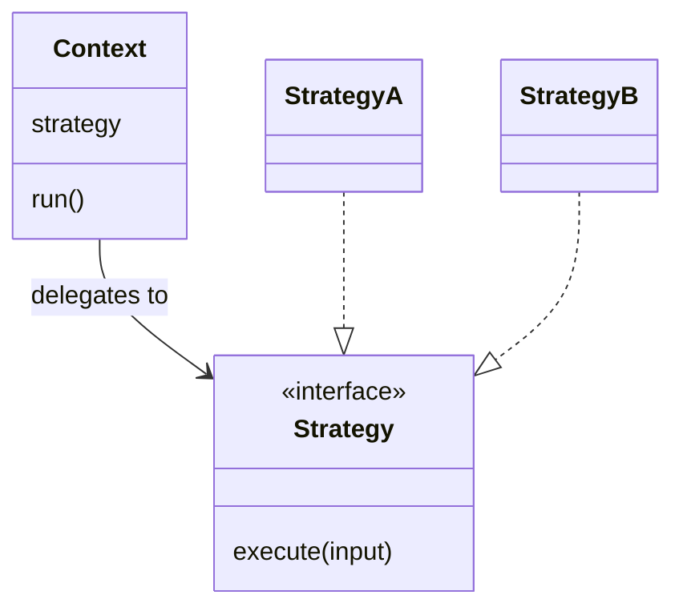

# Strategy

## The problem

The SQLite store has to answer queries, and there is no single best way to
answer one. For "all users ordered by age, first ten" the right move is to
walk the index on `age` and stop after ten rows. For "users where
`city == "Paris"`" it is to read one key of the index on `city`. For "users
where `name in ["Ann", "Bob"]`" it is two point lookups. For "all users" it
is to read the documents table itself.

Written naively, that becomes one long function: `if` there is an ordering,
build this SQL and loop this way; `else if` there is an equality, build that
SQL; and so on, with the paging, filtering, limiting and sorting logic
repeated in each branch with small differences.

The same shape of problem appears in three smaller places:

- A store scan must apply a security filter, but the store must not know
  what security rules are.
- The rules evaluator must call built-in methods (`size`, `matches`,
  `hasAll`, ...) without a growing `switch` in the middle of the evaluator.
- Passwords must be hashed with bcrypt in production and with something
  instant in tests.

## The pattern

A strategy is an interchangeable way of doing one job. The code that needs
the job done (the **context**) is written against the general shape of the
job, and the specific way is supplied from outside.



The benefit is that choosing *which* way and carrying it *out* become
separate pieces of code, each simpler than the combined version.

## In candledb

### A strategy as a value: the query plan

[`internal/adapters/sqlite/plan.go`](../../../internal/adapters/sqlite/plan.go)
splits query answering in two. `planQuery` chooses; `DB.Query` executes.
What passes between them is a `plan`:

```go
// plan describes one way to read candidate documents for a query.
type plan struct {
	// useIndex selects the idx table; otherwise the docs table is scanned
	// in document ID order.
	useIndex bool
	field    string
	kind     int
	// spans are the key ranges to scan. Most plans have one; "in" and
	// "array-contains-any" have one per listed value.
	spans []span
	// idFrom and idTo bound a docs-table scan (inclusive, "" = open).
	idFrom, idTo string
	desc         bool
	// ordered reports that rows arrive in the query's final order. Then the
	// scan can stop as soon as the limit is reached, which is what makes
	// "the first 10 of a million" cheap.
	ordered bool
}
```

This is the strategy pattern with a twist: the strategies are not different
types with different code. They are different *values* of one struct, and a
single executor interprets the fields. "Scan the `age` index descending and
stop early" is `plan{useIndex: true, field: "age", desc: true, ordered:
true, spans: ...}`. "Two point lookups" is a plan with two spans and
`ordered: false`.

The chooser is a sequence of cases in priority order. Its first case:

```go
// With an ordering, walk the index of the first ordered field in the
// requested direction, restricted by any filters on that same field.
if len(q.Orders) > 0 {
	first := q.Orders[0]
	sp := span{}
```

and its last:

```go
// Nothing usable: read the collection itself, in ID order.
p := plan{ordered: true}
if q.Start != nil {
	p.idFrom = string(q.Start.Values[0].(domain.String))
}
if q.End != nil {
	p.idTo = string(q.End.Values[0].(domain.String))
}
return p
```

The executor does not know why a plan was chosen. It asks the plan for SQL
(`plan.statement`), reads pages, and consults two fields: `spans` (how many
scans) and `ordered` (may it stop at the limit, or must it collect and
sort). The file comment names the pattern and explains the safety net that
makes simple strategies acceptable: whatever the plan returns is
re-checked against the domain's definition of the query.

Because a plan is plain data, it can be printed and asserted on.
`TestPlanChoosesOrderedScans` checks the chooser alone, with no database:

```go
{"no filter", domain.Query{}, false, true, 0},
{"equality", domain.Query{Filters: []domain.Filter{eq}}, true, true, 1},
{"range without order", domain.Query{Filters: []domain.Filter{gt}}, true, false, 1},
{"in", domain.Query{Filters: []domain.Filter{in}}, true, false, 2},
{"one ordering", domain.Query{Orders: []domain.Order{byA}}, true, true, 1},
{"range and order on one field", domain.Query{Filters: []domain.Filter{gt}, Orders: []domain.Order{byA}}, true, true, 1},
{"two orderings", domain.Query{Orders: []domain.Order{byA, byB}}, true, false, 1},
```

and when the differential test finds a wrong result it prints the plan,
which usually shows the mistake at once.

### A strategy as a function: `keep`

The storage port's `Query` takes a function:

```go
// Query returns the documents selected by q, in query order. keep, when
// not nil, is an extra filter that is applied before the limit, so a
// limited query still returns as many documents as it can.
Query(ctx context.Context, q domain.Query, keep func(domain.Document) bool) ([]domain.Document, error)
```

`keep` is a strategy for "should this document be in the result". The
application supplies one that evaluates security rules
([`app/read.go`](../../../internal/app/read.go)); an admin caller supplies
none; the differential test supplies one that keeps documents with an even
digit in their ID. The store calls it without knowing which it has.

There is no `Filter` interface and no struct implementing it. In Go, when a
strategy is a single operation, a function type is the whole pattern.

### A table of strategies: built-in methods

The rules evaluator meets `x.size()` and must run the code for `size`. In
[`internal/rules/builtins.go`](../../../internal/rules/builtins.go):

```go
// method is the signature of a built-in method such as "text".size().
type method func(recv domain.Value, args []domain.Value) (domain.Value, error)
```

```go
var methods = map[string]method{
	"size":    size,
	"keys":    keys,
	"values":  values,
	"get":     mapGet,
	"hasAll":  listTest(func(list, want domain.Array) bool { return all(want, list.Contains) }),
	"hasAny":  listTest(func(list, want domain.Array) bool { return anyOf(want, list.Contains) }),
	"hasOnly": listTest(func(list, want domain.Array) bool { return all(list, want.Contains) }),
	"matches": matches,
	"lower":   stringMap(strings.ToLower),
	"upper":   stringMap(strings.ToUpper),
	"trim":    stringMap(strings.TrimSpace),
}
```

Each entry is a strategy for one method name. The evaluator's call site is
one line, `methods[fn.name](recv, args)`, and never changes when a method
is added.

Look at `hasAll`, `hasAny` and `hasOnly`. They are produced by `listTest`,
a function that takes a small strategy (the actual set comparison) and
returns a `method` with all the argument checking wrapped around it:

```go
// listTest builds a method that takes one list argument and answers a
// yes/no question about the receiver list and that argument.
func listTest(test func(recv, arg domain.Array) bool) method {
	return func(recv domain.Value, args []domain.Value) (domain.Value, error) {
		list, ok := recv.(domain.Array)
		if !ok {
			return nil, errReceiver
		}
		if len(args) != 1 {
			return nil, errArguments
		}
		arg, ok := args[0].(domain.Array)
		if !ok {
			return nil, errArguments
		}
		return domain.Bool(test(list, arg)), nil
	}
}
```

That is a strategy used to build strategies. `stringMap` does the same for
`lower`, `upper` and `trim`. The type names for the `is` operator
(`typeNames`) are a third table of the same kind.

### A strategy as an interface: `PasswordHasher`

Where the job has more than one operation and carries configuration, the
interface form is right:

```go
// PasswordHasher is the port to a password hashing algorithm.
type PasswordHasher interface {
	Hash(password string) (string, error)
	// Verify reports whether password matches hash.
	Verify(hash, password string) bool
}
```

`bcrypthash.Hasher` implements it with a cost factor;
[the auth tests](../../../internal/app/auth_test.go) implement it with
string concatenation. This is at once a strategy (interchangeable
algorithm) and a port (boundary to a library). The two patterns describe
the same structure from different motives: strategy is about varying
behaviour, port is about isolating technology.

## What Go changes

- **Functions are values.** Most classic strategy hierarchies exist because
  the language could not pass a function. `keep func(domain.Document) bool`
  replaces an interface, two classes and a constructor.
- **Closures carry state.** The `keep` built in `runQuery` captures the
  service, the context and the principal. A strategy object's fields are
  the closure's captured variables.
- **Data can be the strategy.** A struct of options interpreted by one
  executor (the `plan`) is often clearer than several types each with an
  `Execute` method, when the variants share most of their logic. It also
  makes the choice inspectable.
- **Maps of functions replace dispatch `switch`es** where the set of names
  is open-ended.

A rule of thumb for which form to use:

| The strategy is... | Use |
|---|---|
| one operation, no configuration | a function type |
| several related operations, or needs set-up and tear-down | an interface |
| a variation in *parameters* of otherwise shared logic | a struct of data |
| selected by a name at run time | a map from name to function |

## Costs and when not to use it

- **The reader must find the implementation.** At `keep(doc)` in the SQLite
  package you cannot see what runs. You have to trace back to the caller.
- **A data-driven strategy can grow flags.** `plan` has three booleans and
  two kinds of bounds. Each new access path is tempted to add a field. Past
  some point, separate executors would be clearer.
- **Tables hide typos until run time.** `methods["size"]` is checked by the
  rules *checker* at parse time (`check.go` rejects unknown method names),
  which is why a bad name is a load-time error and not a nil-function
  panic. A table without such a check is a trap.
- **One variant is not a strategy.** If there were only ever bcrypt and the
  tests could afford it, `PasswordHasher` would be an interface for its own
  sake.

Do not introduce a strategy for a choice that is made once, at compile
time, in one place. An `if` is a fine way to choose between two things.

## Questions to check your understanding

1. In `planQuery`, a query with one ordering produces `ordered: true` and a
   query with two orderings produces `ordered: false`. What does the
   executor do differently, and why can it not stop early in the second
   case?
2. The `in` operator produces a plan with one span per listed value, and
   `DB.Query` then keeps a `seen` map. Which operator makes `seen`
   necessary, and with what data?
3. `keep` is called by the store "before the limit". Find the line in
   `DB.Query` that guarantees this and the line in `domain.Query.Apply` that
   does the same for the memory store.
4. What happens if a rules file calls `"abc".reverse()`? At which stage is
   it rejected, and by which function?
5. `hasOnly` is defined as
   `listTest(func(list, want domain.Array) bool { return all(list, want.Contains) })`.
   Explain in words what `want.Contains` is here, given that `Contains` is a
   method.

<details>
<summary>Answers</summary>

1. With `ordered: true`, rows arrive in final order, so the executor stops
   as soon as it has `Limit` results (and when a row falls past the end
   cursor). With two orderings the index gives the order of the first field
   only; rows with equal first values are ordered by document ID in the
   index, not by the second field. So the executor must read the whole span,
   sort with `q.Compare`, and cut to the limit afterwards.
2. `array-contains-any`. A document whose array holds two of the wanted
   values, say `tags: ["a", "b"]` for `array-contains-any ["a", "b"]`, has
   an index row under each, so it is read once per span. `seen` keeps it
   from being returned twice. With `in` on an ordinary field a document has
   one value and appears under at most one span.
3. In `DB.Query`: `if keep != nil && !keep(doc) { continue }` comes before
   `out = append(out, doc)` and before the `len(out) == q.Limit` check. In
   `domain.Query.Apply`: the loop that builds `out` tests
   `(keep == nil || keep(doc))`, and the cut to `q.Limit` happens after the
   sort that follows the loop.
4. It is rejected when the rules are parsed, by `checker.expr` in
   `rules/check.go`, in the `*callExpr` case for a `*memberExpr` function:
   the name is looked up in `methods` and a `SyntaxError` "unknown method
   reverse" is returned. The server refuses to start (or to reload) with
   that file.
5. It is a method value: the method `Contains` bound to the particular
   array `want`. The expression `want.Contains` is a function of type
   `func(domain.Value) bool` that, when called with `v`, runs
   `want.Contains(v)`. It is passed to `all` as the predicate.

</details>

## Try it

**Add a `startsWith` method to the rules language.**

Goal: `request.resource.data.slug.startsWith("post-")` works in a rule.

1. Add an entry to the `methods` table in `rules/builtins.go`. It takes one
   string argument and returns a `domain.Bool`. Decide whether `stringMap`
   fits (it does not: look at its signature) and write the function
   directly, following `matches`.
2. Add rows to `TestExpressions` in `rules/rules_test.go`: a match, a
   non-match, a non-string receiver (which must deny), and a wrong argument
   count.

How to verify: `go test ./internal/rules` passes, and
`candledb check-rules` accepts a file using the method. Count the files you
edited outside the table and its test. That number is what the table
pattern buys.

A harder variant: teach `planQuery` a new strategy. Take a query with two
orderings whose first field also has an equality filter, for example
`where a == 1`, `orderBy a`, `orderBy b`. The current plan scans the index
of `a` and reports `ordered: false`, so the executor reads every match and
sorts. But all matching rows have equal `a`, so the final order is really
"by `b`, then by ID". Add a case that scans the index of `b` with
`ordered: true` and leaves `a == 1` to the row-by-row check. Work out first
why the direction of the ID tie-break still comes out right. The
differential test (`go test ./internal/adapters/sqlite -run Agree`) will
tell you whether you were right, and `TestPlanChoosesOrderedScans` is where
the new case should be asserted.

Next: [Interpreter](interpreter.md)
